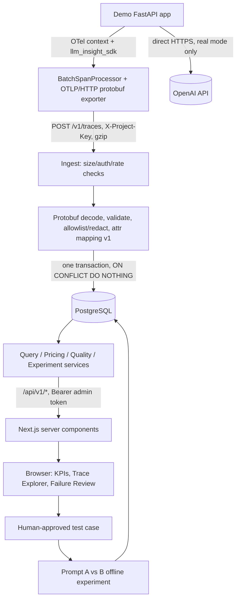

# LLM Insight — Architecture, Data & API Contracts

Status: **contract (Phase 0)**. No component is implemented yet. Decisions are recorded in `ADR.md`, wire details in `TELEMETRY_CONTRACT.md`, and security rules in `SECURITY.md`.

## 1. Components

| Component | Tech | Responsibility | Phase |
|---|---|---|---|
| `backend/` | FastAPI modular monolith, SQLAlchemy 2, Alembic, PostgreSQL | OTLP ingest, query API, pricing/ledger, reviews, datasets, experiments | 1–4 |
| `sdk/` | Independent Python package on the OTel SDK | Tracer/Resource setup, `BatchSpanProcessor`, OTLP/HTTP protobuf exporter, OpenAI wrapper, mock adapter | 2 |
| `demo_app/` | Small FastAPI app | Root HTTP span → LLM child span; real (opt-in) or mock provider | 2 |
| `frontend/` | Next.js, TypeScript, Tailwind, Recharts | Server-side data fetching, KPIs, trace explorer, review/dataset/experiment UI | 3–4 |
| PostgreSQL | Docker Compose | Single store (ADR-02) | 1 |

The platform does **not** proxy model calls. The instrumented app calls OpenAI directly and only telemetry flows to LLM Insight.

## 2. Data flow



## 3. Sequence: one instrumented request

```mermaid
sequenceDiagram
    participant Client
    participant Demo as Demo app (+SDK)
    participant LLM as OpenAI or mock adapter
    participant Exp as BatchSpanProcessor
    participant Ing as Backend /v1/traces
    participant DB as PostgreSQL
    participant UI as Next.js (server)
    Client->>Demo: POST /v1/summarize
    Demo->>Demo: start SERVER span (root)
    Demo->>LLM: chat request (CLIENT span "chat {model}", attempt=1)
    LLM-->>Demo: response + usage (or 429/timeout → error.type)
    Demo->>Demo: end CLIENT span with gen_ai.usage.* and provenance
    Demo-->>Client: response (never waits on export)
    Exp-)Ing: async batch, protobuf (+gzip), short timeout
    Ing->>Ing: limits → auth → decode → validate → allowlist
    Ing->>DB: BEGIN; upsert trace, spans, usage_records; COMMIT
    Ing-->>Exp: 200 ExportTraceServiceResponse (or 4xx/5xx Status)
    Note over Exp,Ing: Backend down → export fails after timeout, app unaffected (ADR-09)
    UI->>DB: (via /api/v1, server-side token) overview / trace tree
```

## 4. Database contract (PostgreSQL)

Conventions: `snake_case`. Surrogate PKs are `BIGSERIAL` or `UUID` (fixed in Phase 1 migration). Timestamps are `TIMESTAMPTZ` in UTC. Money is `NUMERIC(20,10)`. Token counts are `BIGINT` and nullable. Every query is project-scoped. Columns marked † are additive (PADR-09, pending approval).

### 4.1 `projects`
`id` PK · `name TEXT NOT NULL UNIQUE` · `created_at TIMESTAMPTZ NOT NULL DEFAULT now()`.

### 4.2 `project_api_keys`
`id` PK · `project_id` FK NOT NULL · `prefix TEXT NOT NULL UNIQUE` · `key_hash TEXT NOT NULL` · `created_at` · `revoked_at TIMESTAMPTZ NULL`.
The raw key is shown once at creation and never stored or logged (see `SECURITY.md` §2).

### 4.3 `traces`
`project_id` FK · `trace_id CHAR(32)` · `service_name TEXT NOT NULL` · `started_at`, `ended_at TIMESTAMPTZ` · `start_ns`, `end_ns BIGINT` · `status TEXT` (`ok`|`error`) · `prompt_version TEXT NULL` · `provenance TEXT` (`real`|`synthetic`|`unknown`) · `span_count INT` · `updated_at`.
`UNIQUE(project_id, trace_id)`. It is a derived summary, recomputed in the ingest transaction as min start, max end, `error` if any span has ERROR, and `synthetic` if any span is synthetic. `prompt_version` is NULL if inference spans disagree.

### 4.4 `spans`
`project_id` · `trace_id CHAR(32)` · `span_id CHAR(16)` · `parent_span_id CHAR(16) NULL` · `name TEXT` · `kind TEXT` (`INTERNAL`|`SERVER`|`CLIENT`|`PRODUCER`|`CONSUMER`|`UNSPECIFIED`) · `start_ns`, `end_ns BIGINT NOT NULL` · `duration_ns BIGINT NOT NULL CHECK (≥0)` · `status TEXT` (`UNSET`|`OK`|`ERROR`) · `status_message TEXT NULL` (truncated to 256) · `error_type TEXT NULL` · `scope_name`, `scope_version TEXT NULL` · `resource_attributes JSONB` · `attributes JSONB` (allowlisted only) · `attributes_schema_version TEXT NOT NULL` · `provenance TEXT`† · `dropped_attributes_count INT`† · `ingested_at`.
`UNIQUE(project_id, trace_id, span_id)`. A span whose parent is missing is an **orphan**. It is shown, never discarded.

### 4.5 `usage_records`
`id` PK · `project_id` · `canonical_call_key TEXT NOT NULL` · `call_key_source TEXT`† (`sdk_attempt`|`provider_response_id`|`span_fallback`) · `trace_id`, `span_id` · `attempt_id INT NULL` · `provider TEXT` · `requested_model`, `response_model TEXT NULL` · `input_tokens`, `output_tokens`, `cached_input_tokens`, `cache_write_input_tokens`†, `reasoning_output_tokens BIGINT NULL` · `usage_source TEXT` (`provider_reported`|`estimated`|`unknown`) · `cost_usd NUMERIC NULL` · `cost_status TEXT` (`computed`|`unknown`) · `cost_unknown_reason TEXT NULL`† (`price_missing`|`usage_missing`|`usage_inconsistent`) · `price_version TEXT NULL` · `provenance TEXT`† · `created_at`.
Constraints:
- `UNIQUE(project_id, canonical_call_key)`
- `CHECK (cost_status='computed') = (cost_usd IS NOT NULL)`
- Cost is never written as 0 to mean "unknown".

This table is not billing-grade.

### 4.6 `model_prices`
`id` PK · `version TEXT NOT NULL` · `provider`, `model TEXT` · `effective_from TIMESTAMPTZ` · `currency TEXT` (`USD`) · `input_per_million`, `output_per_million NUMERIC NOT NULL` · `cached_input_per_million NUMERIC NULL` · `cache_write_input_per_million NUMERIC NULL`† · `source_url TEXT NOT NULL` · `verified_at TIMESTAMPTZ NOT NULL`.
`UNIQUE(provider, model, version)`. Rows are seeded **only** from verified official prices (Phase 2); Phase 0 seeds none.

### 4.7 Evaluation tables
- **`test_datasets`**: `id`, `project_id`, `name`, `created_at`.
- **`test_cases`**: `id`, `dataset_id`, `origin_trace_id CHAR(32) NULL`, `sanitized_input TEXT NOT NULL`, `expected_output JSONB NULL`, `rule JSONB NOT NULL` (`json_schema` | `field_match` | `exact` | `regex`), `approved_by TEXT NOT NULL`, `approved_at TIMESTAMPTZ NOT NULL`, `redaction_applied BOOL NOT NULL`.
  - No row exists without approval (T34). Redaction runs before insert (T35).
- **`experiments`**: `id`, `dataset_id`, `prompt_version_a`, `prompt_version_b`, `model`, `mode` (`real`|`mock`), `budget_usd NUMERIC NULL` (required when `real`), `started_at`, `finished_at NULL`.
- **`experiment_results`**: `experiment_id`, `test_case_id`, `prompt_version`, `passed BOOL NULL` (NULL = not evaluated), `duration_ms`, `input_tokens`, `output_tokens NULL`, `cost_usd NULL`, `cost_status`, `provenance` (`real`|`synthetic`; `mode=mock` ⇒ `synthetic`).

### 4.8 `failure_reviews` (CR-03)
`id` PK · `project_id` · `trace_id CHAR(32) NOT NULL` · `span_id CHAR(16) NULL` (related span) · `issue_type TEXT NOT NULL` · `evidence TEXT NOT NULL` · `hypothesis TEXT NOT NULL` · `review_status TEXT NOT NULL DEFAULT 'open'` · `reviewer_decision TEXT NOT NULL DEFAULT 'pending'` · `created_by TEXT` · `created_at`, `updated_at`.

| Enum | Values | Meaning |
|---|---|---|
| `issue_type` | `retrieval_missing`, `chunk_boundary`, `prompt_instruction`, `generation_mismatch`, `schema_violation`, `unknown` | A category of *suspected* failure, taken from Phase 4 instructions. Adding a value requires an ADR. |
| `review_status` | `open` → `in_review` → `closed` | Workflow state |
| `reviewer_decision` | `pending`, `hypothesis_supported`, `hypothesis_rejected`, `inconclusive` | Human verdict on the hypothesis. `hypothesis_supported` means the evidence supports it, **not** that the root cause is proven. |

Invariant: `review_status='closed'` ⇒ `reviewer_decision <> 'pending'`.

### 4.9 Indexes
- `spans(project_id, trace_id, start_ns)`
- `traces(project_id, started_at DESC)`
- `usage_records(project_id, created_at, provider, response_model)`
- `project_api_keys(prefix)` (unique)

A JSONB GIN index is added only when a measured need appears.

## 5. API contract

Base URL: backend bound to `127.0.0.1`.
- `/v1/traces` uses `X-Project-Key`.
- All `/api/v1/*` endpoints require `Authorization: Bearer <LLMI_ADMIN_TOKEN>` (constant-time compare; `401` otherwise) and a `project` (id) parameter.
- A record from another project returns `404`, never another project's data (T28).

| Endpoint | Method | Contract | Phase |
|---|---|---|---|
| `/health/live` | GET | `200 {"status":"live"}`, no DB access, not traced | 1 |
| `/health/ready` | GET | `200` if DB `SELECT 1` succeeds within 1 s, else `503`; not traced | 1 |
| `/v1/traces` | POST | See `TELEMETRY_CONTRACT.md` | 1 |
| `/api/v1/traces` | GET | `project`, `from`, `to` (ISO-8601 UTC, max 31-day window), `model`, `status`, `limit` (default 50, max 200), `cursor`. Returns `{items, next_cursor}`, newest first | 1 (stub) / 3 |
| `/api/v1/traces/{trace_id}` | GET | Span tree (parent-child + orphans), usage rows, linked reviews | 1 (stub) / 3 |
| `/api/v1/overview` | GET | KPIs and trends (see `METRICS_CATALOG.md`), each with `n` and provenance split | 2 (service) / 3 |
| `/api/v1/models/compare` | GET | Per provider/model/prompt_version totals, `cost_status` counts, sample N | 3 |
| `/api/v1/failure-reviews` | POST | Body `{trace_id, span_id?, issue_type, evidence, hypothesis}` → `201`; `PATCH /{id}` for status/decision | 4 |
| `/api/v1/datasets/{dataset_id}/cases` | POST | Requires `approved: true`, `approved_by`, and sanitized input; otherwise `422`, nothing stored | 4 |
| `/api/v1/experiments` | POST | `{dataset_id, prompt_version_a, prompt_version_b, model, mode, budget_usd?}`. `mode=real` requires `budget_usd` and the server flag `LLMI_ALLOW_REAL_LLM=true` | 4 |
| `/api/v1/experiments/{id}` | GET | Per-version pass/fail, N, p50/p95 duration, cost with unknown count, provenance label per result | 4 |

Error body for `/api/v1/*`: `{"error": {"code": "...", "message": "..."}}` (JSON). Validation errors return `422`. Responses never include keys, tokens or stack traces.

## 6. Version pins (candidates; CR-09)

Data was read from PyPI, npm and endoflife.date on 2026-10-24. Each candidate is the newest stable release published **on or before 2026-10-10**, so it is at least two weeks old. Lockfiles are produced when the component is first implemented, with versions re-checked then. Nothing is installed in Phase 0.

| Area | Pin | Local status / note |
|---|---|---|
| Python | 3.12.x (Docker `python:3.12-slim`) | 3.12.6 installed. SQLAlchemy 2.1 and pydantic-settings need ≥ 3.11 |
| Node.js | 22 LTS (EOL 2027-04-30) | 22.11.0 installed. Next 16 needs ≥ 20.9. Update to the latest 22.x patch recommended |
| PostgreSQL | 17 (Docker `postgres:17`, EOL 2029-11) | Conservative choice over 18 |
| Backend | fastapi 0.143.0 · uvicorn 0.54.0 · pydantic 2.14.0 · pydantic-settings 2.15.0 · sqlalchemy 2.1.4 · alembic 1.20.0 · psycopg 3.3.6 | |
| OTel | opentelemetry-api / -sdk / -proto / -exporter-otlp-proto-http 1.45.1 · protobuf 7.36.2 (proto requires `>=5,<8`) · opentelemetry-instrumentation-fastapi 0.66b1 (beta line, demo only) | |
| Provider | openai 3.28.0 | Used only by the SDK adapter and demo |
| Eval / test | jsonschema 4.26.0 · pytest 9.1.1 · httpx 0.28.1 · ruff 0.17.0 | |
| Frontend | next 16.4.0 · react / react-dom 19.3.0 · tailwindcss 4.3.3 · recharts 3.10.1 · @playwright/test 1.64.0 · eslint 10.12.0 | |
| TypeScript | **UNKNOWN, decided in Phase 3**. Options are 5.9.3, 6.0.3 or 7.0.2 | Next 16 compatibility with TS 7 (native port) is not verified |

## 7. Repository layout (target)

The layout follows master plan §G. Folders are created only by the phase that fills them; there are no empty layers.

| Phase | Creates |
|---|---|
| 0 | `docs/` (incl. `fixtures/`, `reports/`), `.gitignore`, `.env.example` |
| 1 | `backend/` (`pyproject.toml`, `alembic/`, `app/{main,api/otel,core,models,repositories,services/ingestion}`, `tests/`), `docker-compose.yml`, `scripts/dev` |
| 2 | `sdk/`, `demo_app/`, `backend/app/services/{pricing,metrics}.py`, `scripts/seed`, `scripts/smoke` |
| 3 | `frontend/`, `backend/app/api/{overview,traces}.py` (full) |
| 4 | `backend/app/api/{reviews,datasets,experiments}.py`, `services/evaluation.py` |
| 5 | CI workflow, `README.md`, `docs/FINAL_DELIVERY_REPORT.md` |

## 8. Deployment posture

Local-only. Compose publishes the backend as `127.0.0.1:8000` and the frontend as `127.0.0.1:3000`. PostgreSQL is not published, or only on `127.0.0.1` in dev. A public deployment needs a separate auth and threat review (`SECURITY.md` §7). There is no claim of production or billing-grade reliability.
