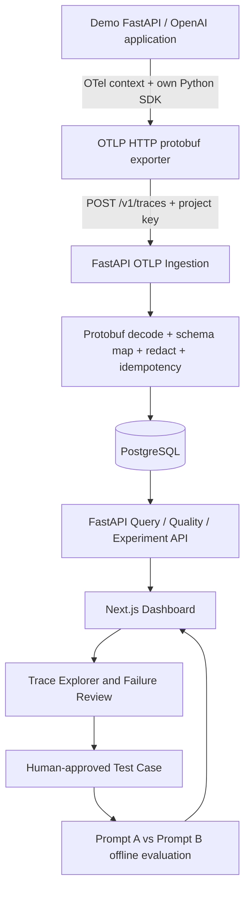

# LLM Insight — Nihai MVP Mimari Kararı ve 14 Günlük Yürütme Planı

**Karar sürümü:** ADR-MVP-1.0 · **Tarih:** 24 Ekim 2026 · **Hedef teslim:** 7 Kasım 2026 (yaklaşık iki hafta)  
**Öncelik sırası:** Doğruluk > uçtan uca çalışabilirlik > veri güvenliği > test edilebilirlik > görsel kalite > özellik sayısı.  
**Önemli:** Bu dosya bir **uygulama planıdır**; çalışan ürün, tamamlanmış faz veya doğrulanmış benchmark iddiası değildir. Günlük süre yerine **çıkış kriterleri** ilerlemeyi yönetir.

## A. Ürün tanımı ve değer önerisi

LLM Insight, LLM uygulamalarından gerçek OpenTelemetry trace'leri alır; gecikme, model, token, maliyet ve hata bilgilerini gösterir; hatalı bir isteği inceleyip onaylı regresyon testine dönüştürür; prompt sürümü değişikliğinin kalite/maliyet etkisini kontrollü veri setiyle karşılaştırır.

**MVP'nin kanıtlayacağı tek çekirdek senaryo:**

1. Demo FastAPI uygulamasından **gerçek** bir OpenAI isteği yapılır; bir adet kök HTTP span ile altında LLM inference span'ı üretilir.
2. SDK, OTLP/HTTP protobuf olarak FastAPI `/v1/traces` alıcısına gönderir; veriler PostgreSQL'e yazılır.
3. Dashboard'da trace ağacı, durum, süre, input/output token, sağlayıcı/model, maliyetin hesap kaynağı ve fiyat sürümü görünür.
4. Kontrollü başarısız LLM cevabı veya JSON schema ihlali `Failure Review` ekranında kanıta dayalı olarak incelenir.
5. Kullanıcı, güvenli ve onaylı input/expected output örneğini regresyon veri setine kaydeder.
6. İki prompt sürümü aynı küçük veri seti üzerinde çalıştırılır; karşılaştırma tablosu gerçek ve simüle sonuçları açıkça ayırır.

**Değer önerisi:** 'Observe → Diagnose → Evaluate → Improve'. Bu, sadece dashboard değil, iyileştirme döngüsüdür. Otomatik kök neden teşhisi, kanıtsız kalite skorları veya fatura kesinliği vaat edilmez.

## B. İki yeni kaynağın değerlendirilmesi

### B1. Perplexity derin araştırma raporu — neler alınacak?

| Konu | Karar | Gerekçe / uygulama |
|---|---|---|
| OpenTelemetry GenAI `gen_ai.*` şeması | **Al** | Kendi özel telemetry şeması yerine sürümlenmiş uyarlayıcı ve standart alanlar. GenAI konvansiyonları hâlen Development olabilir. |
| Resmî OTLP/HTTP protobuf | **Al** | `/v1/traces`, ExportTraceServiceRequest ve ExportTraceServiceResponse sözleşmesi. JSON-only, özel event endpoint'i ile ikame etme. |
| ClickHouse + PostgreSQL + Collector | **MVP'de alma** | Gerçek analitik ölçekte mantıklı, iki haftalık bireysel MVP'de işletme/test karmaşıklığını artırıyor. PostgreSQL + indeksli sorgular ve sınırlı hacim yeterli. |
| Kendi FastAPI protobuf receiver | **Al** | Projenin kendine ait ingestion katmanı; OTLP standardına uyum ve demo açıklanabilirliği. |
| LiteLLM cost map yaklaşımı | **Kısmen al** | Tam gateway kurma; yalnızca doğrulanmış, sürümlenmiş **yerel küçük fiyat konfigürasyonu**. Kaynağı, geçerlilik tarihi, cache fiyatı, para birimi saklanır. |
| Sağlayıcı raporlu usage ve alt kırılımlar | **Al** | Cache/reasoning alt kümelerini toplam token'a ikinci kez ekleme. Bilinmeyenleri 0 kabul etme. |
| Örneklemeden bağımsız usage ledger | **Kısmen al** | MVP'de **sampling kapalı**, aynı transaction'da idempotent usage kaydı; production-grade mali kesinlik iddia etme. |
| Deterministik kalite değerlendirme | **Al** | JSON schema ve golden set kuralları; ölçülen/hesaplanan/eval sonuçları ayrı. |
| LLM-as-judge, Ragas, DeepEval, ClickHouse ölçeği | **Sonraya** | Değerlendirme maliyetini, bağımlılıkları ve belirsizliği yükseltir; MVP'de kaliteli offline kurallar daha savunulabilir. |
| Güvenlik, KVKK, redaction, retention | **Al** | Metadata-only default, whitelist, project key, veri saklama/silme ve yalnızca sentetik demo payload'ları. |

**Not:** Araştırma raporundaki bazı tablolar birbiriyle karışabilir: inference işlemleri için `gen_ai.client.inference.duration` tercih edilir, genel `gen_ai.client.operation.duration` inference metriği olarak üretilmez; sunucu TTFT/TPOT metrikleri, harici sağlayıcı kullanan **istemci** ölçümleri olarak gösterilmez. Doğrulama: https://github.com/open-telemetry/semantic-conventions-genai/blob/main/docs/gen-ai/client-inference.md

### B2. Birleşmiş transkript — araç seçimi filtresi

Transkript sosyal medya konuşmalarının birleşimidir; ürün mimarisi spesifikasyonu veya bağımsız benchmark değildir. Bazı eklenti isimleri konuşmadan yazıya dönüşüm hatası taşıyabilir (`Cloud`/`Claude`, `wipecoding`, `SuperBash`/`SuperViz`, `Strix`/`streaks`, `Headroom`/`Hydroom` vb.). **Sırf duyuldu diye kurulum yapılmayacak.**

| Araç / öneri | Karar | Gerçek fayda / risk |
|---|---|---|
| **Playwright** test runner / isteğe bağlı Playwright MCP | **Kullan** | Trace Explorer, filtre, hata akışı için deterministik E2E; MCP yalnızca görsel hata ayıklamada açılmalı. |
| **Context7** | **İsteğe bağlı, kapsamlı değil hedefli** | FastAPI / OTel / Next.js'in değişen API'lerini kontrol etmekte yararlı. Her promptta sürekli çağrılmasın. |
| **CLAUDE.md + kısa faz sözleşmeleri** | **Kesin kullan** | Sürekli tekrarlanan içerik yerine kısa proje kuralları ve gerektiğinde okunan faz belgeleri. |
| **Claude Code Setup** (Anthropic verified) | **İsteğe bağlı** | İhtiyaç doğarsa hook / skill önerir; ilk güne zorunlu kurulum değil. |
| **Frontend Design** | **İsteğe bağlı** | Kopya tasarım yerine kendi dashboard bileşenleri; temel UI yeterli. |
| **Claude Mem / Headroom / 248 agent / token azaltma** | **MVP'de kurma** | Tasarruf iddiaları ölçülmemiş; üçüncü taraf bağlam işleme/izin ve hata yüzeyi ekler. Önce yerleşik `/clear`, `/compact`, dar dosya okuma. |
| **NotebookLM–MCP ile '%99 tasarruf'** | **Kurma** | Bu yüzde kaynakta kanıtlanmıyor; dokümanın yeniden bulunması, hassas kaynak paylaşımı ve üçüncü taraf MCP riskleri var. Repo içi `docs/` ve selektif okuma yeterli. |
| **OmniRoot / Free LLM API otomatik fallback** | **Kurma** | Kimlik bilgisi, maliyet ve model kalitesi kontrolünü azaltabilir; ücretsiz/sınırsız iddiaları doğrulanmadı. |
| **Strix, güvenlik saldırı ajanları, Agent Reach** | **MVP'de kurma** | Kapsam/izin/saldırı yüzeyi büyür; `bandit`, `pip-audit`, `npm audit`, bilinen güvenlik testleriyle başla. |
| **SuperBash/Supabase MCP** | **Kurma** | PostgreSQL migrasyonları Alembic/CLI ile tekrarlanabilir; ek DB MCP gereksiz. |
| **Kod inceleme, secret scan, rate limit, test** | **Kesin uygula** | Eklenti olmadan CI, lint, secret kontrolleriyle otomatikleştir. |
| **Google Analytics / SEO** | **MVP dışında** | Geliştirici altyapısı projesinde güvenlik ve veri gizliliği daha önemli. |

Doğrulama: https://claude.com/resources/articles/steering-claude-code-skills-hooks-rules-subagents-and-more ; https://support.claude.com/en/articles/14552983-models-usage-and-limits-in-claude-code ; https://github.com/microsoft/playwright-mcp ; https://context7.com/docs/overview ; https://claude.com/marketplace/plugins

## C. Kilitlenen mimari kararlar (ADR)

| Kod | Karar | Durum |
|---|---|---|
| ADR-01 | **Modüler monolith FastAPI backend + bağımsız Python SDK + Next.js dashboard** | Kilitli |
| ADR-02 | **Tek PostgreSQL** (JSONB/raw whitelisted attributes + normalize tablolar); ClickHouse yok | Kilitli, ölçek gözden geçirmesi sonra |
| ADR-03 | **Doğrudan OTLP/HTTP protobuf `/v1/traces` alımı**. İleriye dönük Collector destekli, MVP yolunda Collector şart değil | Kilitli |
| ADR-04 | Yalnızca **traces sinyali** için receiver; `/v1/metrics`, `/v1/logs` MVP kapsamında değil | Kilitli |
| ADR-05 | **OpenAI için tek çalışan SDK adaptörü**; provider/model genel veri modeli; Gemini sonra | Kilitli |
| ADR-06 | **Sampling kapalı**; span + usage ledger aynı kalıcı veri tabanında, idempotent. Fatura-grade garanti yok | Kilitli |
| ADR-07 | **Metadata-only by default**; demo için ayrı ve açıkça opt-in sentetik içerik modu | Kilitli |
| ADR-08 | **Bir projelik yerel/admin demo**, ingestion API key; herkese açık çok kiracılı SaaS/üyelik yok | Kilitli |
| ADR-09 | **Asenkron, sınırlı buffer / BatchSpanProcessor + kısa export timeout**; export başarısızlığında iş uygulaması durmaz | Kilitli |
| ADR-10 | **Quality = deterministik/golden-set + insan onayı**, otomatik LLM-as-judge sonraya | Kilitli |
| ADR-11 | Sürümlenmiş fiyat matrisi, Decimal maliyet, `unknown` maliyet durumları | Kilitli |
| ADR-12 | Uçtan uca izleme `trace_id` → inceleme → test case → deney sonucu akışı | Kilitli |

### Mimari veri akışı



**Veri yönü:** SDK standart exporter kullanır; backend gerçek protobuf'u parse eder. Model çağrısı **platform üzerinden proxy edilmez**; instrumented uygulama doğrudan OpenAI'e gider. OTel collector, ClickHouse veya Redis ilk sürüm için eklenmez. `ExportTraceServiceResponse` başarılı kabulde protobuf ve HTTP 200 döndürülmelidir; hata için doğru 4xx/5xx kullanılmalıdır. Gzip başlık desteği ve Content-Type testi dahil. Resmî protokol: https://opentelemetry.io/docs/specs/otlp/

### Neden rapordaki Collector/ClickHouse mimarisini şimdilik seçmedik?

Raporun bu önerisi yanlış değil, **başka ölçekte optimize edilmiş**. İki hafta içinde ClickHouse şeması, Collector exporter, iki veritabanı, ayrı işleme worker'ı, kuyruk ve bunların testleri ana hedefi geciktirir. Kendi OTLP alıcımız hem mühendislik katkısını görünür kılar hem de küçük projede daha az servis gerektirir. **Gelecek geçiş eşiği:** yüksek hacimli span sorgusu PostgreSQL indeks ve retention politikalarına rağmen ölçülen SLA'yı bozduğunda ClickHouse; veri kaybı veya export tıkanması gerçek yük testinde sorun olduğunda Collector + disk queue; otomatik judge ağırlaştığında ayrı worker.

## D. MVP fonksiyonellik sözleşmesi

### D1. P0 (sunum için zorunlu)

- HTTP root span + `gen_ai.client.inference` span, trace/parent ilişkileri, `service.name`, `project_id` sunucu tarafı kimliği.
- Provider (`openai`), request/response model, prompt version, latency_ms, durum, hata sınıfı, token input/output; output token alt kümeleri.
- Token kaynağı: `provider_reported`, `estimated`, `unknown`; fiyat kaynağı, `price_version`, hesaplanan USD Decimal, `cost_status`.
- Trace id ile span ağacı; tarih/proje/model/status filtreleri, p50/p95/p99, hata oranı, maliyet/toplam çağrı grafikleri.
- Bozuk protobuf, auth, payload boyutu, mükerrer span, eksik token, timeout, 429, telemetry endpoint down testleri.
- Gerçek OpenAI demo uygulaması + deterministik sahte adapter. Ücretli çağrı varsayılan testlerde yapılmaz.
- `/v1/traces` raw prompt/response/PII kaydetmez. API key DB'de hashlenir, yanıt ve loglara sızmaz.
- Failure Review: trace inceleme + manuel `issue_type`, `evidence`, `hypothesis`, `review_status`.
- Trace-to-Testset: **yalnızca insan onayıyla** güvenli test case ekleme; anonimleştirilmiş veya sentetik içerik.
- Offline evaluation: JSON schema validation + golden expected match, iki `prompt_version` için başarı/maliyet/gecikme kıyası; eksik veriyi ayrı gösterme.
- En az 24 kritik otomatik test, hedef toplam **48 senaryo**. README, demo, mimari diyagram, videoya hazır akış.

### D2. P1 (P0 tamamlanırsa)

- Streaming için client time-to-first-chunk ve first meaningful content ayrımı; streaming iptali.
- Basit eşik uyarıları (cost/error/latency), safe CSV export, retention job ve kullanıcı geri bildirimleri.
- Second provider adapter / OpenInference-normalizer (mevcut şemayı bozmadan).

### D3. MVP dışı

ClickHouse, Redis/S3/Kafka, Collector zorunluluğu, çoklu tenant/billing, self-hosted LLM, full RAG, otomatik agent orchestration, otomatik LLM-as-judge, çoklu provider otomatizasyonu, production internet exposure, karmaşık RBAC, mobil uygulama, 64 metriğin tamamı. Eski rapordaki **64 metrik bir metrik kataloğu**, MVP için implementasyon zorunluluğu değildir.

## E. Veri modeli (asgari)

**İsimlendirme PostgreSQL, migration ile gerçeklenir; alanların hepsi tanımlı nullable/required ve indeksli olmalı.**

| Tablo | Çekirdek alanlar | Kurallar |
|---|---|---|
| `projects` | id, name, created_at | MVP tek proje, genişletilebilir |
| `project_api_keys` | id, project_id, prefix, key_hash, revoked_at | Raw key yalnızca ilk oluşturma anında; API key hiçbir log'a yazılmaz |
| `traces` | project_id, trace_id, service_name, started_at, ended_at, status, prompt_version | UNIQUE(project_id, trace_id); özet gerektiğinde türet |
| `spans` | project_id, trace_id, span_id, parent_span_id, name, kind, start/end_ns, status, whitelisted JSONB, attributes_schema_version | UNIQUE(project_id, trace_id, span_id), parent eksikse orphan göster |
| `usage_records` | project_id, canonical_call_key, trace_id, span_id, attempt_id, provider, requested_model, response_model, input_tokens, output_tokens, cached_input_tokens, reasoning_output_tokens, usage_source, cost_usd, cost_status, price_version, created_at | UNIQUE(project_id, canonical_call_key); **billing-grade değil**; eksik veri null+status |
| `model_prices` | version, provider, model, effective_from, currency, input_per_million, output_per_million, cached_input_per_million nullable, source_url, verified_at | Maliyet hesaplarında fiyatın hangi sürüm kullanıldığı belli |
| `failure_reviews` | id, project_id, trace_id, category, evidence, hypothesis, reviewer_decision, status, created_at | Olası neden ≠ kanıtlanmış gerçek |
| `test_datasets` | id, project_id, name, created_at | Onaylı test setleri |
| `test_cases` | id, dataset_id, origin_trace_id nullable, sanitized_input, expected_output, rule, approved_by, approved_at | Açık onay ve redaction; kaynak trace referansı |
| `experiments` | id, dataset_id, prompt_version_a, prompt_version_b, model, mode(real/mock), started_at, finished_at | Aynı set üzerinde karşılaştırma |
| `experiment_results` | experiment_id, test_case_id, prompt_version, passed, duration_ms, input/output_tokens, cost_usd nullable, provenance | Mock gerçek gibi görünmez |

**Indeksler:** `spans(project_id, trace_id, start_ns)`, `traces(project_id, started_at DESC)`, `usage_records(project_id, created_at, provider, response_model)`; gerekirse JSONB GIN sadece ölçülmüş ihtiyaçta. PostgreSQL versiyonları ve migration'ları pinle.

**Maliyet kuralı:** Yalnızca inference span'daki **fiziksel API attempt** usage kayıtlarına yazılır. Parent span maliyet toplamaz. Provider response ID varsa canonical key oluşturmak için kullanılabilir; yoksa SDK'nın ürettiği `llminsight.call_id + attempt_id` kullanılmalı; diğer kaynaklarda yalnızca `trace_id/span_id` best-effort fallback, durumu belgelenmeli. Aynı span re-export edilirse on-conflict idempotent; farklı retry attempt'leri gerçekten faturalandırılabilirse ayrı kayıt. Toplam input token cache_read'i **içerir**, cached alt küme ayrıca input'a eklenmez; reasoning output, output toplamının parçasıdır. Bilinmeyen fiyat veya token → `cost_status=unknown`, **0 dolar değil**. Maliyet API tahminidir, provider faturası garantisi değil.

**Zaman:** OTel nanosecond epoch ve start/end korunur; süre matematiği `end_ns - start_ns`, negatif / taşma reddi veya işaretlenmesi. İstatistikler span mı request mi olduğu UI'da açık: inference count, trace count farklıdır. Dashboard p95 örnek sayısı ile gösterilir; kalite skoru null ise panelde 'değerlendirilmedi'.

## F. API sözleşmesi

| Endpoint | HTTP | İş |
|---|---|---|
| `/health/live`, `/health/ready` | GET | Sağlık / DB readiness; gürültülü tracing yok |
| `/v1/traces` | POST | OTLP HTTP protobuf, `X-Project-Key`; boyut sınırı, Protobuf `ExportTraceServiceRequest` → `ExportTraceServiceResponse` |
| `/api/v1/overview` | GET | KPI ve trendler; `from,to,project` filtreli |
| `/api/v1/traces` | GET | Pagination, model/status/date; proje kapsamlı |
| `/api/v1/traces/{trace_id}` | GET | Span hiyerarşisi + usage + review; başka projenin kaydı görünmez |
| `/api/v1/models/compare` | GET | Model/prompt toplamları, cost_status sayısı, sample N |
| `/api/v1/failure-reviews` | POST | Manual issue/evidence/review kaydı |
| `/api/v1/datasets/{dataset_id}/cases` | POST | Onaylı sanitized test case ekleme |
| `/api/v1/experiments` | POST | İki prompt sürümünün **kontrollü, bütçe limitli** offline deneyi; mock/real flag |
| `/api/v1/experiments/{id}` | GET | Metrikler, her test sonucu, veri kaynağı etiketi |

**Protokol uyumu:** request content type `application/x-protobuf`, opsiyonel gzip, boyut ve bozuk içerik kontrollü hataları; başarılı olduğunda `HTTP 200` ve protobuf `ExportTraceServiceResponse`. Partial success'i ancak gerçek bir kısmî kabul mekanizması uygulanıyorsa standarda uygun kullan, aksi halde atomik batch ve uygun hata kodu. 4xx'leri gereksiz tekrarlama; 429/5xx için sınırlı retry/backoff exporter sorumluluğu. `OTEL_EXPORTER_OTLP_TRACES_ENDPOINT`/headers geçişini test et. Yanlış UUID string formatı ve parent yoksa orphan semantiği test et.

**Güvenlik ve arayüz:** İlk sunum yerel/kontrol edilen makinede çalışır. Next.js tarafında backend read/admin anahtarları **server-only** env'de, client bundle veya localStorage'a yazılmaz. Herkese açık deploy edilirse önceden güçlü admin auth (session/cookie, CSRF değerlendirmesi), TLS, IP/rate limit ve proje yetkilendirmesi zorunludur. Mimari MVP demo güvenliğini gerçek multi-tenant production security ile karıştırma.

## G. Klasör yapısı (Claude için sözleşme)

```text
llm-insight/
  CLAUDE.md
  README.md
  .env.example
  docker-compose.yml
  docs/
    PRD.md
    ADR.md
    TELEMETRY_CONTRACT.md
    METRICS_CATALOG.md
    SECURITY.md
    DEMO_SCRIPT.md
    PHASE_STATUS.md
    ARCHITECTURE.md
  backend/
    pyproject.toml
    alembic/
    app/
      main.py
      api/{otel.py,overview.py,traces.py,reviews.py,datasets.py,experiments.py}
      core/{config.py,security.py,telemetry_mapping.py}
      models/
      schemas/
      services/{ingestion.py,pricing.py,metrics.py,evaluation.py}
      repositories/
    tests/{unit,integration,security}/
  sdk/
    pyproject.toml
    llm_insight_sdk/{__init__.py,config.py,instrumentation.py,openai_adapter.py}
    tests/
  demo_app/
    app.py
    fixtures/
  frontend/
    app/{page.tsx,traces,models,reviews,experiments}/
    components/
    lib/
    tests/
  scripts/{dev,seed,smoke}/
```

Dosya isimleri öneridir; Phase 0 sonunda sözleşmeyle sabitlenir. Karar değişikliği `docs/ADR.md` kaydı ve gerekçesi olmadan yapılmaz. Sırf klasör olsun diye boş katman oluşturma. **Ölçülemeyen ve kullanılmayan soyutlama ekleme.**

## H. 14 günlük teslim hedefi — süre değil kabul kriteri odaklı

Başlangıç referansı **24 Ekim**, sunum hedefi **7 Kasım 2026**. Eğer uzun bir gün çalışırsan birden fazla fazı kapatabilirsin. 14 günü keskin 14 günlük görev listesi yerine altı ayrı kapı olarak yönet.

| Faz | Önerilen takvim penceresi | Hedef / kapı | Pay |
|---|---|---|---:|
| **Phase 0** | 24 Ekim | PRD, ADR, mevcut repo denetimi, kontratlar, test matrisi, mock demo senaryosu | %8 |
| **Phase 1** | 25–27 Ekim | Docker/Postgres/Alembic, gerçek `/v1/traces` protobuf ingestion, kimlik, idempotent span kayıtları | %22 |
| **Phase 2** | 28–30 Ekim | Python SDK + demo OpenAI + provider usage + pricing/ledger + telemetry down testi | %24 |
| **Phase 3** | 31 Ekim–2 Kasım | Gerçek DB destekli dashboard, trace tree, model/cost/latency grafikleri | %19 |
| **Phase 4** | 3–4 Kasım | Failure Review, onaylı Trace-to-Testset, deterministik offline experiment comparison | %17 |
| **Phase 5** | 5–7 Kasım | 48 senaryoluk hedef test matrisi, E2E, güvenlik, performance smoke, README/demo video | %10 |

**Kritik yol:** İlk üç faz bitmeden veri akışı yoktur; Phase 3'e mock-only UI ile geçmek yasak. **Freeze:** Phase 4 bitince mimari/özellik değişikliği yok; final faz sadece kusur düzeltme, test, belge, sunum. Hedefe yetişmiyorsa uyarı sistemi/streaming/ikinci sağlayıcı iptal edilir, P0 çekirdeği korunur.

### Phase 0 — Definition (yazılım başlamadan)

**İş:** Mevcut repo varsa gerçekten kontrol et; varsayımsal dosya veya tamamlanmış kod söyleme. PRD, 12 ADR, OTLP contract, metrik sözlüğü, 48 test ID'si, güvenlik ve demo fixture taslağı; tek proje SDK + backend versiyonları/pinning. `CLAUDE.md` kısa. `docs/PHASE_STATUS.md` başlangıçla. 

**Kabul:** Açık P0/P1/P2, sabit API/DB sözleşmeleri, örnek span fixture, kaynak ve risk listesi, 6 fazın check-list'i mevcut. Kod yazma veya stack'i izinsiz genişletme.

### Phase 1 — Backend / veri temeli

**İş:** FastAPI + Postgres + Alembic + docker-compose; API key hash, OTLP request decode, hex trace/span IDs, `resourceSpans`/`scopeSpans`/`spans` gezimi, `AnyValue` tipleri, whitelist/redaction, idempotent upsert, successful protobuf response, `health/ready`, pytest integration.

**Kabul:** Standard exporter veya doğrudan protobuf fixture → `/v1/traces` → veri tabanı; 3-span bir trace doğru bağlanır; aynı yük 2 kez gönderilince DB'de tekil kalır; anahtar eksik/geçersiz, bozuk payload, gzip/boyut ve transaction rollback testleri geçer.

### Phase 2 — SDK / kullanım ve maliyet doğruluğu

**İş:** bağımsız Python package, OpenTelemetry SDK exporter, `ObservedOpenAIClient`/wrapper, context propagation (demo FastAPI root + LLM child), usage mapping, latency,error,retry, fiyat tablosu/version, Decimal hesap, `usage_records`, null+status, provider mock and real smoke. `BatchSpanProcessor`/timeout; export fail-open; producer app latency ölçümü.

**Kabul:** **Gerçek** çağrı (kullanıcı anahtarının bulunması şartıyla) trace ve sayılarıyla düşer. Anahtar yoksa fake adapter aynı data contract'ı gösterir ama UI'da `SYNTHETIC` etiketi taşır. Tekrar gönderim maliyet çarpmaz; cached subset ve unknown testleri geçer. Telemetry backend kapalıyken ana app exception atmadan yanıt üretir. Test koşumları gerçek API harcamasına bağlanmaz.

### Phase 3 — Dashboard ve araştırılabilirlik

**İş:** Next.js/Tailwind, server-side güvenli veri çağrısı; 4 KPI, filtreli trace list, span timeline/tree, duration/token/cost/status, provider/model prompt-version compare, provenance/missing-status etiketleri, boş ve hata durumları; backend pagination/index.

**Kabul:** Dashboard **seeded DB'den** ve mümkünse **gerçek SDK trace'inden** veriyi çeker; sabit mock sayı göstermez. Trace altında parent-child ilişkisi görselleşir. Yanlış p95, çifte sayılan cost, 'unknown'ı sıfır gösterme veya client bundle'da secret hatası yoktur. Playwright smoke.

### Phase 4 — Observe → Diagnose → Evaluate → Improve

**İş:** Manual failure review formu (`category`, `evidence`, `hypothesis`), ilişkili span seçimi, sanitized test case teklif/onay akışı, deterministik JSON schema/golden testler, prompt version A/B evaluation. Testlerden kopuk 'kalite yüzdesi' yok; karşılaştırmada `N`, örneklem ve gerçek/sentetik ayrımı; gerçek LLM deneyine bütçe limiti.

**Kabul:** Bir test case insan onayı olmadan kaydedilemez; içerik maskelenir; en az 1 başarısız örnek → review → approved dataset → A/B deneyi → karşılaştırma izlenebilir. Kalite ölçümleri yeniden çalıştırıldığında deterministik; yanlış kök neden kesin gerçek gibi gösterilmez.

### Phase 5 — Final QA ve sunum

**İş:** migrations from clean clone, lints, unit/integration/Playwright, API key and PII scan, request limit, rate limiting, retry duplicate, missing cost, DB outage, performance smoke, docs, GitHub README, video senaryosu, demo rollback. Phase 4 freeze korunur; mevcut P0 bug varsa öncelik ver.

**Kabul:** `docker compose up --build` + yönergedeki init → demo; 48 senaryoluk raporda her case PASS/FAIL/SKIP açık; **kritik testlerde 0 FAIL**, güvenlik engeli yok, eksikler belgeli, 3–5 dk demo tekrarlanabilir.

## I. Kalite kapıları ve otomatik test matrisi (48)

Bu testler **planlanan testlerdir, çalıştırılmadı**. P0 çekirdek olanlar `*` ile işaretlendi.

| Grup | Kimlikler ve senaryolar |
|---|---|
| Ingestion (8) | T01* valid protobuf request, T02* parent-child, T03* resource/service name, T04* duplicate upsert, T05* invalid key, T06* corrupt protobuf, T07 gzip valid, T08* oversized payload |
| SDK (8) | T09* real/mock client span attributes, T10* nested context, T11* provider success usage, T12* 429/timeout status, T13* export-down fail-open, T14 retry attempt IDs, T15 no secrets in span, T16 no content default |
| Cost/metrics (8) | T17* provider token priority, T18* unknown token/cost null, T19* Decimal known fixture, T20* cached subset no double count, T21* reasoning subset no double count, T22* price version persisted, T23* duplicate usage ignored, T24* p95 sample + percentiles math |
| API/DB (8) | T25* pagination, T26* timestamp timezone, T27* orphan span, T28* project filter auth, T29* empty aggregation, T30* DB outage/transaction rollback, T31 migration clean recreate, T32* status counts and total distinct API calls |
| Evaluation/workflow (8) | T33* failure review create, T34* no approval no test case, T35* redaction before case save, T36* golden JSON pass, T37* golden JSON fail, T38 prompt A/B same dataset, T39* evaluation provenance labels, T40 missing expected output handling |
| Security/UI/Delivery (8) | T41* XSS escape on labels, T42* server-only API secret, T43* request rate limit, T44 malformed header/auth log sanitization, T45* trace list UI screenshot assertion, T46* drilldown tree E2E, T47 reproducible compose smoke, T48* real vs synthetic provenance on dashboard |

**Bir fazın 'PASS' raporu yalnızca gerçek terminal output/CI loglarıyla verilir.** `pytest`, `ruff`, frontend lint/typecheck/build, `playwright test`; mümkünse Github Actions CI. T01/T04/T17/T19/T20/T23/T34/T35/T42/T46 sunum bloklayıcıdır. Hedef benchmark: en az 100–1000 span fixture ile tekrar ingest ve 10k span veri setinde trace açılış süresini ölç; **önceden uydurulmuş latency hedefi veya grafik yok**. P95 SQL/NumPy matematiği fixture ile doğrulanır.

## J. Güvenlik, gizlilik ve operasyon

- **Prompt/response default kapalı.** `span.attributes` için allowlist; yasak alanlar asla raw JSONB'e sızmasın. Otel attributes'da token dışı hassas payload görülebilir; parser da redact etmeli.
- Test case input'u yalnızca **sentetik** veya açık izinli redacted metin olmalı. Privacy-friendly capture modu opt-in, örnekleme değil kontrollü içerik kaydıdır.
- `X-Project-Key`: güçlü rastgele token; hash, constant-time verification, revocation; log'da header'ı yazma. Rate limiting ve max body size.
- API server local-only varsay; `0.0.0.0` bağlamasını Docker network ile sınırla, public ingress açma. Admin dashboard public olursa auth planı olmadan yayınlama.
- SQL parameterized ORM, `limit/max_page_size`, tarih sorgusu sınırlama, XSS escape, UI CSP değerlendirmesi, secrets `.env.example` dışında asla commit edilmez.
- Retention: demo için yapılandırılabilir örn. 14 gün, gerçek veri için gereksinim ve mevzuat incelemesi. Erişim ve silme fonksiyonları MVP'de tasarım seviyesinde net, üretimde kapsamlı KVKK incelemesi şart.
- Idempotent ingest retriable olmalı. **Kalıcı queue yok:** backend tamamen erişilemezken exporter buffer/timeout dışında garantili teslim yok. Mimaride at-most-best-effort dışına söz verilmez; kritik billing sistemine dönüştürülmez.

## K. Cost / hız / kalite optimizasyonu

**Uygulama altyapısı:** Yerel Docker Compose + PostgreSQL maliyeti $0 altyapı gideri (donanım/elektrik hariç). Gerçek LLM testleri için kullanıcı tanımlı harcama limiti (örnek bütçe $5–15; garanti değil), demo mock testleri ücretli API çağrısı yapmaz. Claude Code abonelik/kullanım limiti ayrıca; model ve fiyat güncel planına göre değerlendirilir.

**Geliştirme sistemi:**

1. Proje kökündeki **kısa** `CLAUDE.md` bütün fazlarda okunur; tüm araştırma raporlarını her oturuma yapıştırma.
2. Yalnızca aktif faz promptu + ihtiyaç duyulan dosyalar okunur; kaynak dosyalara toplu kör okuma yok.
3. Her faz için yeni Claude Code oturumu veya `/clear`; devam eden büyük hata ayıklamada `/compact`. `/model` ile hesabındaki modelleri kontrol et; rutin kod/test için ekonomik güçlü model, zor mimari sorun için üst model.
4. İsteğe bağlı **Context7**, yalnızca güncelliği kritik belirli API için. **Playwright** test runner kesin; Playwright MCP yalnızca UI görsel hata ayıklamada.
5. Kod geliştirme esnasında dosya izinlerini dar tut; üçüncü taraf MCP'lere API key, gizli repo veya müşteri verisi vermeden önce izin/dokümantasyon incele.
6. Testleri fixture/mock ile tekrar edilebilir tut, CI'da gerçek API harcamasını kapat. Gerçek LLM smoke yalnızca manuel komut/harcama limiti ile.
7. Her faz sonunda `docs/PHASE_STATUS.md` güncelle ve commit/tag oluştur. PR review gerekiyorsa ayrı kısa oturum veya başka bir modelle bağımsız inceleme.

Anthropic referansları: https://support.claude.com/en/articles/14552983-models-usage-and-limits-in-claude-code ; https://claude.com/resources/articles/steering-claude-code-skills-hooks-rules-subagents-and-more

## L. Faz bitiş raporu sözleşmesi (Claude Code zorunlu)

```markdown
# Phase N — Delivery Report
- Commit/tag:
- Created/changed files:
- Locked ADR/contracts affected (if any):
- What works, confirmed by commands:
- Commands and exact outcomes (pass/fail/skip):
- Manual test results + screenshots/paths:
- Security & cost risks:
- Deviations and ADR proposals (not silently changed):
- Open issues with priority/severity:
- Next phase prerequisite checklist:
- Verdict: PASS / BLOCKED (do not self-certify without evidence)
```

**Komutları çalıştırmadıysan 'NOT RUN' yaz. Testler başarısızsa düzelt veya engeli açıkça bildir.** Tasarım kararlarını kendiliğinden yeniden müzakere etme. Üretim anahtarı, internet açık servis, fatura doğuracak yük testleri için kullanıcı onayı iste.

## M. Demo senaryosu (3–5 dakika)

1. 'Demo application' gerçek OpenAI isteği başlatır (API yoksa **simulated** mod etiketi görünür); trace-id alınır.
2. LLM Insight Dashboard sayısal KPI ve son istekle güncellenir (refresh / poll). İstek süresi, token, model, usage provenance, maliyet sürümü incelenir.
3. Trace Explorer üzerinde kök HTTP → child LLM span ağacı, isteğe ait hata veya gecikme görülür.
4. Bilerek hatalı JSON çıktısı alınır; Failure Review'da kanıta dayalı hipotez yazılır; onayla test case'e dönüştürülür.
5. Prompt A/B offline deney sonucu gösterilir; başarı oranı, örnek sayısı, süre ve hesaplanan maliyet kıyaslanır. Mock/real ayrımı ekranda belirgin.
6. 'Nasıl ölçüyoruz?' slaytında OTLP protobuf, idempotency ledger, maliyet bilinmiyor durumu ve veri gizliliği açıklanır.

## N. Tek kaynaktan uygulama sırası

**İlk iş:** `Claude_Code_Phase_Prompts.md` dosyasındaki **Bootstrap + Phase 0** talimatı. Claude Code Phase 0'ı raporlayıp **dursun**. Burada kontrol ettikten sonra Phase 1'e geç.

**Referanslar:**

- Bu planın iki kullanıcı kaynağı: `birlesmis_transkript.txt`, `LLM Gözlemlenebilirlik Platformu — Derin Araştırma Raporu.md`.
- Önceki konuşmanın bağlamı: `Proje önerilerini sunma.pdf`, özellikle son v1.1 güncelleme (tam 1.244 satırlık v1.1 Markdown ayrıca ekli **değildi**; onun var olmayan detayları yeniden üretildi iddia edilmez).
- OTel spec https://opentelemetry.io/docs/specs/otlp/
- Python exporter https://opentelemetry.io/docs/languages/python/exporters/
- GenAI client inference https://github.com/open-telemetry/semantic-conventions-genai/blob/main/docs/gen-ai/client-inference.md
- GenAI spans https://github.com/open-telemetry/semantic-conventions-genai/blob/main/docs/gen-ai/gen-ai-spans.md
- Context7 https://context7.com/docs/overview
- Playwright https://github.com/microsoft/playwright-mcp
- Claude Code https://support.claude.com/en/articles/14552983-models-usage-and-limits-in-claude-code

*Bu belge planlama ve kaynak-doğrulama sonucudur; dosyalar/dokümanlar Claude Code tarafından henüz uygulanmadı. Sürüm kararlarını değiştirmek için test kanıtları ve yeni ADR gerekir.*
