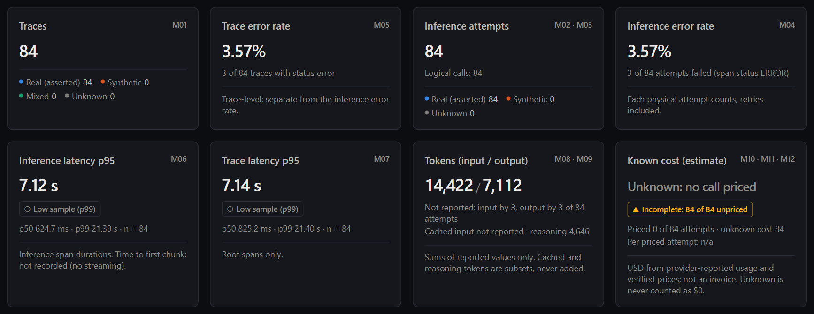
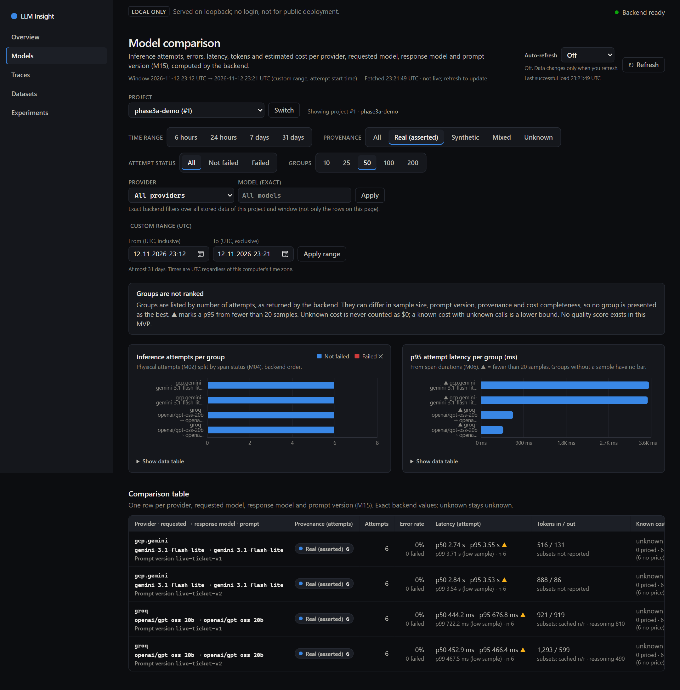
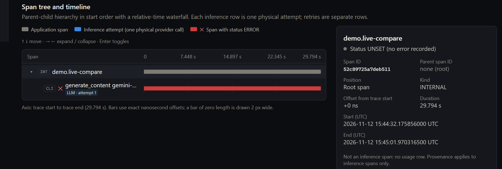
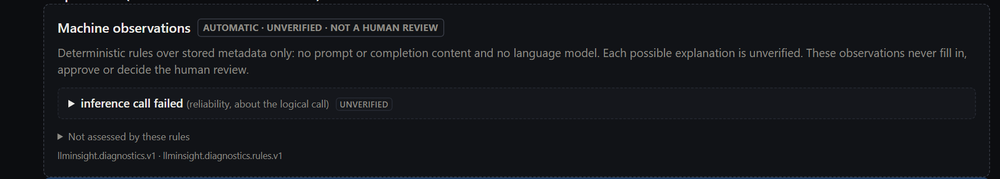
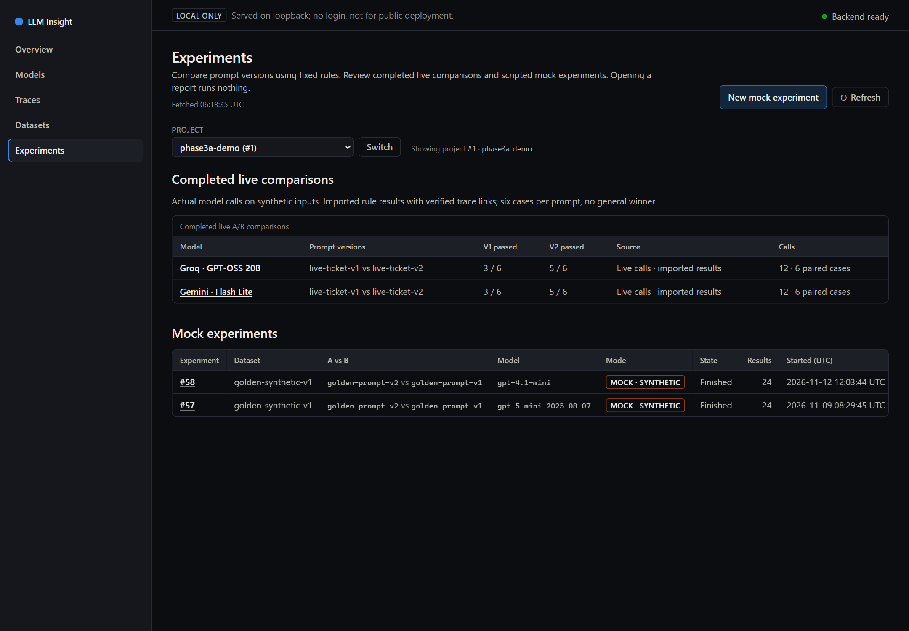
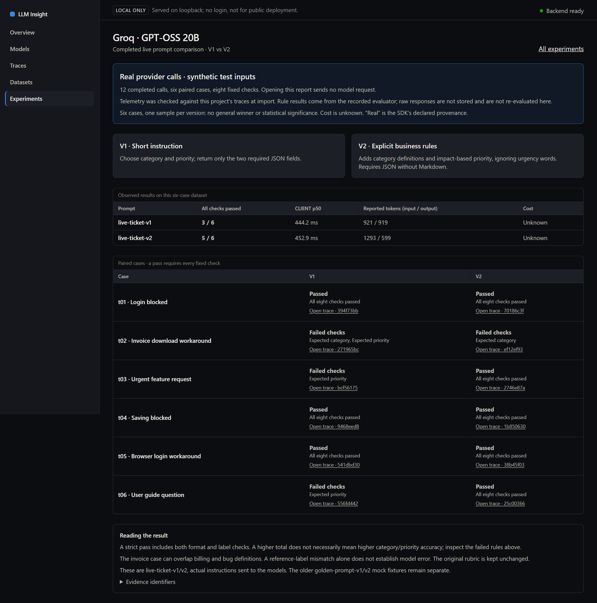
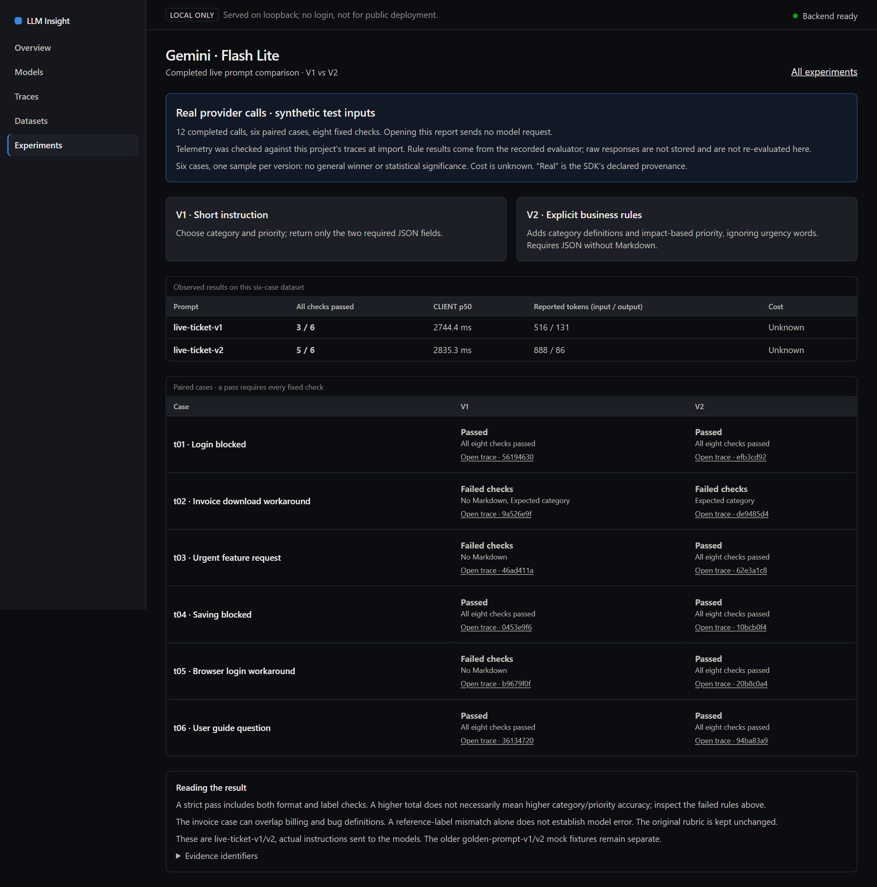
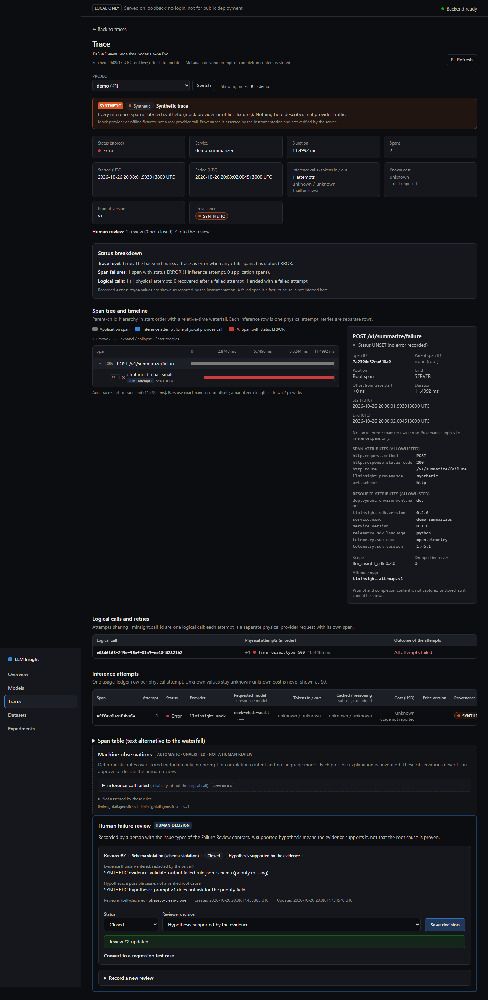

@cover
SoftITo Yapay Zeka Akademisi
Bitirme Projesi Raporu

**Proje Adı:** LLM-Insight — Büyük Dil Modeli Uygulamaları için Gözlemlenebilirlik, Hata Analizi ve Prompt Değerlendirme Platformu

**Proje Sahibi:** Murat Elber Kaya

**Grup/Dönem:** SoftITo 4 Dönem – Yapay Zeka-2

Yerel MVP • Teknik uygulama ve deney sonuçları

@page
@toc
@page
# 1. GİRİŞ
Bu bölümde LLM-Insight projesinin amacı, hedef kullanıcıları, çözmeye çalıştığı problem ve mevcut uygulama sınırları açıklanmaktadır. Proje, büyük dil modeli kullanan uygulamalarda gözlem verisini mühendislik kararlarına dönüştüren bir yerel geliştirme platformudur.
## 1.1. Projenin Amacı
Bir dil modeli çağrısının yanıt üretmesi, uygulamanın doğru çalıştığını tek başına göstermez. Çağrı teknik olarak başarılı olduğu hâlde istenen JSON biçimini bozabilir, yanlış kategori seçebilir veya gereğinden uzun sürebilir. Farklı sağlayıcıların token ve model alanlarını farklı biçimlerde sunması da karşılaştırmayı zorlaştırır. Geliştiricinin hem teknik davranışı hem görev başarısını ayrı olarak izleyebilmesi gerekir.
LLM-Insight’ın amacı; çağrı sürelerini, hata durumlarını, model ve sağlayıcı bilgisini, token tüketimini ve hesaplanabilir maliyeti ortak bir veri modelinde toplamak; sorunlu çağrıları incelemek; insan değerlendirmesinden regresyon vakası üretmek ve prompt sürümlerini aynı girdiler üzerinde karşılaştırmaktır. Hedef kullanıcılar LLM uygulaması geliştiren yazılım geliştiriciler, test mühendisleri ve yapay zekâ proje ekipleridir.
Projenin çalışma döngüsü “Gözlemle → Teşhis Et → Değerlendir → İyileştir” olarak tanımlanmıştır. Bağımsız Python SDK, uygulamadaki çağrılardan OpenTelemetry span’leri üretir. FastAPI bu kayıtları alır ve PostgreSQL’e işler. Next.js paneli özet metrikleri, trace ayrıntılarını, insan incelemelerini, veri setlerini ve deney raporlarını sunar. OpenTelemetry iz kavramı ve taşıma standardı bu zincirin ortak dilini sağlar [1–3].
Somut kullanım örneği, destek taleplerinin kategori ve öncelik açısından sınıflandırılmasıdır. Geliştirici V1 ve V2 promptlarını aynı altı sentetik talep üzerinde çalıştırır; JSON yapısı ve referans etiketler sabit kurallarla değerlendirilir. Her sonucun ilgili gerçek çağrı kaydına bağlanması, ölçümün hangi çağrıdan geldiğini gösterir. Böylece yalnızca toplu bir başarı oranı değil, başarısız kural ve örnek vaka da incelenebilir.
Proje kapsamında yeni bir temel dil modeli eğitilmemiştir. Katkı; gözlemlenebilirlik hattı, veri bütünlüğü, mahremiyet odaklı kayıt tasarımı, insan onaylı değerlendirme akışı ve karşılaştırma sonuçlarının izlenebilir sunumudur. Güncel uygulama, tamamlanmış canlı deneyleri panelde görüntüler; paneldeki yeni deney çalıştırma formu ise mock akışına aittir [18–20].
@page
## 1.2. Proje Kısıtları
- Kısıt 1 — Veri kapsamı: Canlı prompt karşılaştırması altı sentetik destek talebi, iki prompt ve iki modelden oluşur. Her koşul tek kez denenmiştir. Bulgular bu görev ve örneklerle sınırlıdır; genel model sıralaması veya istatistiksel üstünlük anlamına gelmez.
- Kısıt 2 — Kayıt mahremiyeti: Telemetri ham prompt ve ham yanıt saklamaz. Model, süre, token, hata ve sürüm gibi izin verilen meta veriler tutulur. İnsan tarafından yazılan test girdileri ayrı bir onay ve maskeleme akışına tabidir. İçerik saklanmaması, geçmiş yanıtların sonradan yeniden puanlanmasını sınırlar.
- Kısıt 3 — Maliyet: Fiyat kataloğu bulunması, her çağrının fiyatlandırılabileceği anlamına gelmez. Sağlayıcının faturalama koşulu doğrulanamıyorsa maliyet “unknown” kalır. Seçilen canlı ölçüm penceresinde 84 çağrının tamamı bu durumdadır; bilinmeyen maliyet sıfır veya ücretsiz olarak yorumlanmaz.
- Kısıt 4 — Veri kaynağı beyanı: “Real (asserted)” etiketi SDK’nın kaynak beyanıdır. Sunucunun trace, model ve token eşleşmesini doğrulaması, sağlayıcı tarafından imzalanmış bir işlem kanıtı oluşturmaz.
- Kısıt 5 — Çalışma ortamı: Uygulama yerel MVP olarak tasarlanmıştır. Tek backend worker, süreç içi hız sınırlama ve sınırlı deney yürütme kullanılır. Çok kullanıcılı üretim, yüksek erişilebilirlik ve yatay ölçekleme doğrulanmış değildir.
- Kısıt 6 — Teslim garantisi: SDK sınırlı bir bellek kuyruğu kullanır; kalıcı disk kuyruğu yoktur. Backend’in uzun süre kapalı kalması, kuyruğun dolması veya sürecin zorla sonlandırılması telemetri kaybına yol açabilir. Tekilleştirme çift sayımı önler; kayıpsız teslim garantisi vermez.
- Kısıt 7 — Değerlendirme: Kurallar biçim ve belirli referans etiketlerini denetler. LLM-as-judge ve genel anlamsal kalite puanı uygulanmamıştır. Fatura indirme vakasında billing/bug etiketlerinin örtüşmesi, referans politikasının da değerlendirilmesi gerektiğini gösterir.
- Kısıt 8 — Kanıtın zamanı: Eski README ve sunum sürümleri daha dar bir MVP kapsamını anlatır. Bu raporda güncel kod ve 13 Kasım canlı deney/veri seti kayıtları esas alınmış, tarihsel benchmark ve test sonuçları ayrıca etiketlenmiştir. Rapor hazırlanırken yeni sağlayıcı çağrısı veya yeni performans deneyi yürütülmemiştir.
@page
# 2. MATERYAL VE YÖNTEM
Bu bölümde veri kaynakları, model entegrasyonları, OpenTelemetry tabanlı gözlem mimarisi, kalıcılık ve değerlendirme yöntemi açıklanmaktadır. Örnek rapordaki veri–model–karar–teslim sırası, burada girdi–çağrı–telemetri–değerlendirme sırasına uyarlanmıştır.
## 2.1. Veri Seti, Model ve Çağrı Kaynakları
**Kavram:** LLM-Insight’ta veri seti, bir model eğitim kümesinden ziyade değerlendirme girdilerinin ve beklenen kuralların koleksiyonudur. Gerçek sağlayıcı yanıtları, sentetik girdilerden üretilebilir; bu nedenle girdinin kaynağı ile çağrının kaynağı ayrı kavramlardır.
**Bileşenler:**
| Kaynak | İçerik | Kullanım ve sınır |
| Golden mock | golden-synthetic-v1, 12 vaka | Deterministik regresyon; gerçek model kalitesi ölçmez |
| Canlı A/B | live-ticket-six-v1, t01–t06 | İki prompt × iki model = 24 gerçek çağrı |
| Panel veri seti | golden_synthetic_v2, 6 vaka | Aynı canlı girdilerin onaylı kopyası; yeni deney değildir |
| Gözlem penceresi | 84 çağrı ve 84 trace | Birden fazla senaryo; canlı A/B bunun alt kümesidir |

Kayıtlı model kimlikleri openai/gpt-oss-20b, qwen/qwen3.8-27b ve gemini-3.1-flash-lite’dır. Groq üzerindeki GPT-OSS, doğrudan OpenAI sağlayıcısıyla karıştırılmaz. Sağlayıcı kullanım alanları ortak token şemasına dönüştürülür [14–16, 18].
**Çalışma Mantığı:** Vaka ve promptlar sabittir; referans etiketler sağlayıcıya gönderilmez. V2 kategori politikasını, iş etkisine göre önceliği ve Markdown kullanmama koşulunu açıklar. Çıktı sınırı ve kurallar iki sürümde aynıdır.
| Vaka | Senaryo özeti | Referans kategori / öncelik |
| t01 | Hiçbir yöntemle oturum açılamıyor | login / high |
| t02 | Fatura düğmesi bozuk; e-postada alternatif var | billing / medium |
| t03 | Acil ifadesi içeren karanlık tema isteği | feature_request / low |
| t04 | Belge kaydı tüm yöntemlerde çöküyor | bug / high |
| t05 | Bir tarayıcıda giriş yok, diğerinde çalışıyor | login / medium |
| t06 | Çalışan uygulama için kılavuz soruluyor | other / low |

**Kullanım Alanları:** Prompt değişikliğinin görev başarısına etkisini incelemek, hata türlerini ayrıştırmak ve sonraki regresyon çalışmaları için sabit referans oluşturmak [19, 20].
@page
## 2.2. Gözlem, Teşhis ve Değerlendirme Mimarisi
**Kavram:** Trace bir işlemin bütününü, span ise bu işlem içindeki zamanlanmış bir adımı temsil eder. Bir uygulama isteği altında birden fazla model çağrısı ve yeniden deneme bulunabilir. LLM-Insight, çağrı girişimlerini CLIENT span olarak kaydederek bu ilişkileri görünür kılar [2, 3].
**Bileşenler:** Bağımsız SDK; sağlayıcı adaptörleri; OTLP/HTTP alıcısı; normalize ve maskeleme katmanı; trace/span/usage tabloları; metrik ve teşhis servisleri; insan incelemesi; veri seti ve deney katmanı. SDK backend kodunu içe aktarmaz. Bu ayrım, gözlenen uygulamanın gözlem sunucusundan bağımsız dağıtılabilmesini sağlar.
**OpenTelemetry uygulaması:** TracerProvider span yaşam döngüsünü, BatchSpanProcessor toplu dışa aktarımı, OTLPSpanExporter ise HTTP üzerinden protobuf iletimini yönetir. Servis adı ve SDK sürümü kontrollü resource alanlarıdır. Otomatik ortam algılayıcılarının gereksiz host veya kullanıcı bilgisi eklememesi için resource açıkça kurulur.
```python
# sdk/src/llm_insight_sdk/telemetry.py
# build_span_exporter gövdesinden alıntı
return OTLPSpanExporter(
    endpoint=config.endpoint,
    headers={PROJECT_KEY_HEADER: config.project_key},
    timeout=config.export_timeout_seconds,
    compression=Compression.Gzip
        if config.compression == "gzip"
        else Compression.NoCompression,
    max_request_size=config.max_request_bytes,
)
```
**Çalışma Mantığı:** Uygulama isteği başlatılır; adaptör model çağrısının başlangıç ve bitişini ölçer; sağlayıcı yanıtındaki model ve kullanım bilgileri span’e eklenir. İzinli alanlar dışa aktarılır. Backend bu veriden trace özeti ve model metriklerini üretir. Otomatik teşhis olası sorunları gösterir; kesin kök neden beyanı yerine insan incelemesine kanıt sağlar.
Temel alanlar gen_ai sağlayıcı/model/kullanım alanları ile proje içi prompt sürümü, çağrı ve girişim kimliğidir. Alan sözleşmesi docs/TELEMETRY_CONTRACT.md dosyasında tanımlıdır. OpenTelemetry GenAI sözleşmeleri gelişebildiği için proje adaptörlerinin kullandığı alanlarla dış standardın sürümü birlikte izlenmelidir [1–3, 17].
**Kullanım Alanları:** Yavaş çağrının bulunması, yeniden denemelerin görülmesi, sağlayıcı karşılaştırması ve tek bir başarısız deney sonucundan ilgili trace’e geçiş.
@page
## 2.3. Telemetri Yaşam Döngüsü, Tekilleştirme ve Güvenilir Kayıt
**Kavram:** Aynı span’in yeniden iletilmesi, çağrı veya maliyet toplamını artırmamalıdır. LLM-Insight taşıma, veritabanı kalıcılığı ve toplulaştırmayı birbirinden ayırır. Başarılı OTLP yanıtı yalnız veritabanı işlemi tamamlandıktan sonra üretilir [1, 17].
| Kimlik / alan | Üreten | İşlev |
| project_id | Backend | Proje kapsamı ve sorgu sınırı |
| trace_id | OpenTelemetry | Uçtan uca işlem kimliği |
| span_id | OpenTelemetry | İşlem içindeki adımın kimliği |
| call_id / attempt | SDK | Mantıksal çağrı ve fiziksel deneme ayrımı |
| response_id | Sağlayıcı | Kullanım kaydının tekilleştirilmesine katkı |
| prompt_version | Uygulama | Hangi talimat sürümünün kullanıldığı |

**Çalışma Mantığı:** İstek türü ve kodlaması kontrol edilir. Proje anahtarı doğrulanır, hız sınırı uygulanır. Gövde sınırlandırılarak okunur; gerekiyorsa gzip açılır. Protobuf çözülür, span sayısı ve alanları doğrulanır. İzinli alanlar normalize edilir; aynı işlem içinde span, trace özeti ve kullanım kayıtları işlenir. Commit başarısızsa başarı yanıtı gönderilmez.
```python
# backend/app/services/ingestion/service.py
# _persist içindeki işlem çekirdeği (alıntı)
session = self.session_factory()
try:
    result = telemetry.persist_batch(session, project_id, spans)
    session.commit()  # HTTP 200 ancak bundan sonra
    return result
except RETRYABLE_DB_ERRORS as exc:
    _rollback_quietly(session)
    logger.error("ingest transaction rolled back: %s",
                 type(exc).__name__)
    raise errors.storage_unavailable() from None
# Diğer hata dalları ve finally: session.close() kısaltılmıştır.
```
**Bileşenler:** Proje kapsamlı tekil anahtarlar, kullanım defteri, içerik çakışması sayaçları ve transaction yönetimi. Aynı span’in tekrarı ile yeni bir model denemesi aynı olay değildir. Bu ayrım, yeniden denemelerin gecikme ve kullanım üzerindeki etkisinin doğru incelenmesine yardım eder.
**Sınır ve kullanım:** Bu tasarım kabul edilmiş kayıtların çift sayılmasını engellemeye yöneliktir. Referans PPE raporundaki SQLite outbox LLM-Insight’ta mevcut değildir. SDK’nın fail-open davranışı gözlenen uygulamanın çalışmasını korurken teslim edilemeyen span’lerin kaybını mümkün kılar. Dolayısıyla “exactly once uçtan uca teslim” iddiası yapılmaz.
@page
**Maliyet ve kullanım bütünlüğü:** Kullanım defteri yalnızca token toplamı tutmaz; verinin sağlayıcıdan gelip gelmediğini, fiyatın uygulanabilirliğini ve kullanılan fiyat sürümünü de izler. Bilinmeyen maliyet kayıtlarının sayısı, bilinen toplamın yanında gösterilir. Bu tercih, eksik verinin yanlışlıkla ucuzluk göstergesine dönüşmesini önler.
Maliyet motoru dört aşamalıdır: token tutarlılığı; faturalama koşuluna uygulanabilirlik; model ve olay zamanına göre fiyat seçimi; Decimal ile hesaplama. Cache okuma/yazma token’ları input’un alt kümesi, reasoning token’ları output’un alt kümesi olarak ele alınır. Aynı token iki kez fiyatlandırılmaz. Python Decimal, ondalık hesaplamayı ikili kayan nokta yuvarlama sapmalarından ayırır [10].
```python
# backend/app/services/pricing.py (alıntı)
def unknown(reason: str) -> CostOutcome:
    return CostOutcome(None, "unknown", reason)

def priced_model(requested_model, response_model):
    return (response_model if response_model is not None
            else requested_model)

# assess() akışından sadeleştirilmiş kontrol
if model is None or not price_applicable(provider, attributes):
    return unknown("price_missing")
```
Bu kod parçasında işlev imzaları okunabilirlik için kısaltılmıştır. Tam uygulama tür denetimlerini ve zaman sürümlü fiyat seçimini içerir. Ücret, para birimi ve fiyat sürümü birlikte saklanır; istemcinin yolladığı serbest bir maliyet değeri doğru kabul edilmez.
| Durum | Anlam | Panel yorumu |
| computed | Kullanım ve uygulanabilir fiyat mevcut | Tahmini USD değeri; fatura değildir |
| usage_missing | Token eksik veya kaynağı uygun değil | Maliyet bilinmiyor |
| usage_inconsistent | Sayılar veya alt kümeler tutarsız | Güvenilir hesap yapılamaz |
| price_missing | Uygulanabilir fiyat kanıtı yok | Sıfır yerine unknown |

Gemini, Groq ve OpenRouter için mevcut motor, telemetriden doğru faturalama koşulunu kanıtlayamadığından fiyatı uygulamaz. Bu yüzden canlı gözlemde tüm çağrıların maliyeti bilinmemektedir. OpenAI için de yalnız model eşleşmesi yeterli değildir; uygun service tier ve uç nokta bilgisi aranır. Bu kurallar proje uygulamasının davranışıdır; sağlayıcıların genel fiyat politikası özeti değildir.
@page
## 2.4. Teknolojik Altyapı
**Sistem Mimarisi:** Uygulama üç ana dağıtım bileşeninden oluşur: bağımsız SDK ile gözlenen uygulama, FastAPI backend ve Next.js dashboard. PostgreSQL kalıcı veriyi tutar. Tamamlanmış canlı A/B raporlarının içe aktarımı ayrı bir yol üzerinden aynı backend’e ulaşır.
@architecture
Şekil 1. LLM-Insight mimarisi. Telemetri ve tamamlanmış deney kanıtı ayrı giriş yollarıdır; tarayıcı backend yönetim anahtarını taşımaz.
**FastAPI Backend:** Python 3.12 tabanlı modüler monolittir. Pydantic istek doğrulamasını, Uvicorn HTTP sunumunu sağlar. API modülleri taşıma ve yetki kontrollerini; servisler iş kurallarını; repository katmanı veritabanı işlemlerini ayırır [4].
**PostgreSQL, SQLAlchemy ve Alembic:** PostgreSQL 17; ilişkisel kimlikler, tekil kısıtlar, zaman damgaları ve JSONB alanları için kullanılır. SQLAlchemy 2.0 veri erişimini, Alembic şema geçişlerini yönetir. Şema 0006 canlı deney snapshot migration’ına kadar gelişmiştir [5–7].
**Arayüz:** Next.js 16, React 19, TypeScript, Tailwind ve Recharts kullanılır. Sunucu bileşenleri backend’den veri okur; etkileşim gerektiren kısımlar istemci bileşenleridir. Yönetim anahtarı sunucuda tutulur [8].
**Çalışma ortamı:** Docker Compose PostgreSQL’i ve isteğe bağlı uygulama servislerini yönetir. Yerel portlar backend için 8000, dashboard için 3001, PostgreSQL için 55432, demo uygulama için 8100’dür. Docker servisleri, ağlar ve volume’lar tek tanımda düzenlenir [9].
@page
# 3. UYGULAMA VE KURULUM ADIMLARI
Bu bölüm, proje kökünden başlayan yerel kurulum sırasını ve uygulama akışlarını açıklamaktadır. Komutlar mevcut depo yapısını esas alan PowerShell örnekleridir. Anahtarlar gerçek değerleriyle rapora eklenmemiştir; ortam dosyaları gizli tutulur.
## 3.1. Geliştirme Ortamının Hazırlanması ve Kurulum
Git, Python 3.12, Docker Desktop ve proje tarafından kullanılan Node.js 22.23.4 gerekir. Backend ile SDK için ayrı sanal ortamlar oluşturulur. Kilit dosyaları bağımlılıkların tekrarlanabilir kurulmasını sağlar. Önce ortam dosyası ve PostgreSQL, ardından migration ve uygulama hazırlanır [17].
```powershell
# Depo kökünde
python -I scripts/dev/init_env.py
docker compose up -d --wait postgres
python -m venv backend/.venv
backend/.venv/Scripts/python -m pip install -r backend/requirements.lock
backend/.venv/Scripts/python -m pip install --no-deps -e backend
Set-Location backend
.venv/Scripts/alembic upgrade head
.venv/Scripts/python -m app.cli create-key --project demo
.venv/Scripts/python -m app.cli seed-prices
.venv/Scripts/python -m app
```
create-key çıktısındaki anahtar yalnız bir kez gösterilir. Bu değer OTEL_EXPORTER_OTLP_TRACES_HEADERS değişkeninde X-Project-Key başlığına yazılır; kaynak koda eklenmez. Anahtar kaybolduğunda mevcut özetinden geri elde edilmez; yeni anahtar oluşturulur. Backend terminali açık bırakılarak ikinci terminalde dashboard hazırlanır.
```powershell
# Yeni terminal; depo kökü
$nodeDir = python -I scripts/dev/install_node.py --print-bin
$env:PATH = "$nodeDir;$env:PATH"
python -I scripts/dev/init_frontend_env.py --project-id 1
Set-Location frontend
npm ci
npm run build
npm start
```
Proje kimliği create-key çıktısına göre seçilmelidir; 1 örnek yerel kimliktir. Dashboard http://127.0.0.1:3001 adresinde açılır. Hazırlık kontrolü backend’in /health/ready ucundan yapılabilir. SDK kurulumu ve örnek trafik Bölüm 3.3’te açıklanmıştır.
Alternatif olarak docker compose --profile app up -d --build --wait komutu uygulama profilini başlatır. Bu profilde backend/dashboard ortak ağ alanı kullanır; host üzerinden OTLP göndermek için README’deki host backend yolu ayrıca gerekir. Veriyi koruyarak durdurmak için docker compose stop kullanılır; volume silme kurulumun olağan adımı değildir.
@page
## 3.2. Veritabanı Şeması, Migration’lar ve Yetki Sınırları
Veri modeli telemetriyi, insan değerlendirmesini ve deney kanıtını farklı tablolarda tutar. Bir trace’e bağlı span’ler çağrı ağacını oluşturur; kullanım kayıtları maliyet hesaplamasının temelidir. İnceleme–test vakası bağı, bir problemin regresyon kümesine nasıl taşındığını gösterir.
| Revizyon | Kapsam |
| 0001 | Çekirdek proje, anahtar, trace, span ve kullanım şeması |
| 0002 | Model fiyatları ve fiyatlandırma desteği |
| 0003 | İnsan incelemeleri, veri setleri ve test vakaları |
| 0004 | İnceleme ve test vakası ilişki bütünlüğü |
| 0005 | Mock deneyler ve sonuçları |
| 0006 | imported_experiments: tamamlanmış canlı deney snapshot’ları |

```python
# backend/app/models/telemetry.py
# Trace.__table_args__ içinden seçilmiş kısıtlar
hex32("trace_id"),
CheckConstraint("start_ns > 0", name="start_ns_positive"),
CheckConstraint("end_ns >= start_ns", name="end_after_start"),
one_of("status", TRACE_STATUSES),
one_of("provenance", TRACE_PROVENANCE),
CheckConstraint("span_count >= 1", name="span_count_positive"),
UniqueConstraint("project_id", "trace_id"),
```
Bu kısıtlar biçim, zaman tutarlılığı ve proje içi kimlik tekilliğini veritabanı düzeyinde korur. JSONB esnek alanlar için kullanılırken temel kimlikler serbest JSON içinde bırakılmaz. Kullanım kaydının tekilleştirilmesi, aynı verinin yeniden dışa aktarılmasında toplamın büyümesini önler.
Canlı deney snapshot’ı proje, run ve model kimliğiyle tekildir. Aynı kanıtın tekrar içe aktarılması mevcut kimliği döndürür; çelişen içerik 409 ile reddedilir. Backend toplamları istemciden doğru kabul etmek yerine proje kapsamlı telemetriyle eşleştirerek üretir [18].
Yetki sınırı proje ingest anahtarı ile yönetim API’si arasında kuruludur. Proje anahtarı telemetri kabulüne, yönetim Bearer token’ı uygulama API’sine aittir. Referans PPE sistemindeki admin/user/viewer rolleri veya ppe_app veritabanı rolü bu projeye taşınmamıştır. LLM-Insight’ta bu adlarla bir rol hiyerarşisi varmış gibi kabul edilmez.
Şema güncellemesi alembic upgrade head ile yürütülür. Migration testleri ORM uyumunu, kurulum ve geri alma davranışını denetler. Canlı deneyler için veri içeren tablonun yıkıcı geri alınmasına karşı korumalar, ilgili entegrasyon testlerinde ele alınmıştır.
@page
## 3.3. SDK’nın Çalıştırılması ve Çağrı Kaynakları
SDK, gözlenen uygulamaya eklenerek model çağrılarının çevresinde ölçüm üretir. Yerel doğrulama için mock sağlayıcı kullanılır; bu yol dış model isteği gerektirmez. Gerçek sağlayıcılar ayrı adaptör ve açık operasyonel kontroller üzerinden çalıştırılır.
```powershell
# Depo kökünde SDK kurulumu
python -m venv sdk/.venv
sdk/.venv/Scripts/python -m pip install -r sdk/requirements-dev.lock
sdk/.venv/Scripts/python -m pip install --no-deps ./sdk
# OTEL_* değişkenleri güvenli biçimde oturuma yüklenmiş olmalı.
sdk/.venv/Scripts/python -m demo_app.web --drive
```
```python
# sdk/README.md örneğinden uyarlanmış mock kullanım
import llm_insight_sdk as lli
from llm_insight_sdk.mock import ObservedMockClient, Scenario

telemetry = lli.init(lli.LLMInsightConfig.from_env())
client = ObservedMockClient(telemetry, max_attempts=3)
with telemetry.tracer.start_as_current_span("handle-request"):
    reply = client.chat(
        model="mock-chat-small",
        messages=[{"role": "user", "content": "sentetik girdi"}],
        scenario=Scenario.RETRY_THEN_SUCCESS,
        prompt_version="v1",
    )
telemetry.shutdown()
```
Bu örnekte girdi model istemcisine verilir ancak telemetriye aktarılmaz. Yeniden denemeler ayrı girişim span’leri olarak gözlenir. Kapanışta sınırlı bekleme ile kuyruk boşaltılmaya çalışılır; başarısız dışa aktarım, ana uygulama hatası gibi sunulmaz.
| Ayar / kaynak | İşlev |
| OTEL_SERVICE_NAME | Servisi tanımlar |
| OTEL_EXPORTER_OTLP_TRACES_ENDPOINT | Yerel /v1/traces alıcısı |
| OTEL_EXPORTER_OTLP_TRACES_HEADERS | X-Project-Key kimlik doğrulaması |
| Mock / sahte transport | Deterministik ve çevrimdışı test |
| Gemini / Groq / OpenRouter adaptörleri | Sağlayıcı yanıtlarını ortak sözleşmeye dönüştürme |

Canlı A/B, demo_app/live_prompt_ab.py ve prompt_ab_scenarios.py üzerinden yürütülmüş ayrı bir akıştır. İzin, kota ve sınır kontrolleri çağrı öncesinde yapılır; ham yanıtın bellekte değerlendirilmesi ile raporlanacak meta veri ayrılır. Raporun üretilmesi bu akışı yeniden çalıştırmaz.
@page
## 3.4. API Katmanı, Proje Kapsamlı Erişim ve Güvenlik
Ingest API ve yönetim API’si farklı kimlik doğrulama yollarına sahiptir. OTLP tarafında gövde okunmadan proje anahtarı ve hız sınırı denetlenir. Yönetim tarafında Bearer token gerekir; dashboard bu anahtarı sunucudan kullanır. Bu uygulama, örnek rapordaki rol tabanlı erişim başlığının LLM-Insight karşılığıdır.
| Uç / yüzey | Görev | Kontrol |
| POST /v1/traces | Protobuf telemetri kabulü | X-Project-Key, gövde ve hız sınırı |
| /api/v1/traces | Liste, detay ve teşhis | Yönetim yetkisi ve proje kapsamı |
| /api/v1/datasets | Veri seti ve vaka akışı | Onay, maskeleme, ilişki kontrolü |
| /api/v1/experiments | Mock deney akışı | Sınırlı ve sentetik yürütme |
| /api/v1/imported-experiments | Tamamlanmış canlı deney kanıtı | Sabit şema, eşleşme, değişmezlik |
| /health/ready | Hazırlık kontrolü | Hassas yapılandırmayı açığa çıkarmaz |

Varsayılan kabul sınırları sıkıştırılmış gövde için 4 MiB, açılmış gövde için 16 MiB, istek başına 2.048 span ve gövde okuma için 10 saniyedir. Bunlar backend/app/core/config.py içindeki yapılandırılabilir değerlerdir. Boyut ve sıkıştırma kontrolleri aşırı bellek kullanımına karşı uygulama sınırı oluşturur.
```python
# backend/app/api/otel.py (alıntı; aradaki kontroller kısaltıldı)
project = await run_in_threadpool(
    ingestor.authenticate,
    request.headers.getlist("x-project-key"), client
)
ingestor.check_ingest_limit(project)
# Sınırlı gövde okuma, gzip ve protobuf doğrulaması ardından:
await run_in_threadpool(ingestor.process, project, wire, gzipped)
return Response(content=_OK_BODY, status_code=200,
                media_type=PROTOBUF)
```
Anahtarın kendisi yerine HMAC özeti saklanır. Yanlış ve iptal edilmiş anahtarlar kabul edilmez. Telemetri alanlarında izin listesi ve hassas veri elemesi uygulanır. İnsan girdilerinde e-posta, telefon ve anahtar benzeri içerikler maskeleme sürecinden geçer; bu mekanizma her olası hassas veriyi tanıyan bir garanti değildir.
Frontend sunucu erişimi, Host/Origin/CSRF kontrolleri ve güvenli metin render yaklaşımıyla desteklenir. Proje dışı referansların reddi, veri seti ve imported experiment testlerinde doğrulanır. Uygulama bugün yerel kullanım kapsamındadır; kurumsal kimlik yönetimi ve internet üzerinden çok kullanıcılı servis ayrı geliştirme gerektirir.
@page
## 3.5. LLM İzleme ve Değerlendirme Paneli
Dashboard, geliştiricinin toplam görünümden tek çağrıya ve deney sonucuna ilerlemesini sağlar. Overview, Traces, Models, Datasets ve Experiments ana yüzeylerdir. Proje, zaman aralığı, sağlayıcı/model ve veri kaynağı filtreleri ölçümün kapsamını belirler. Görüntüler mevcut yerel uygulama kayıtlarından alınmıştır; görseldeki sayılar yeni bir çalıştırmanın sonucu değildir.
**Overview:** Trace ve inference sayısı, hata oranı, p50/p95 süreleri, bilinen maliyet ve bilinmeyen maliyet adedi birlikte sunulur. Örneklem büyüklüğü n görünür tutulur. Seçilen günlük ölçümde 84 çağrı ve üç teknik hata vardır.

KPI alanındaki maliyet bilgisi, veri eksikliğini saklamadan sunulur. 84 çağrının maliyeti bilinmiyorsa, bilinen toplam tek başına toplam harcama olarak okunmamalıdır. Aynı şekilde teknik hata oranı da görev doğruluğuyla eş anlamlı değildir. Biçim kuralını geçemeyen bir model cevabı teknik olarak başarılı bir çağrı olabilir.

Zaman filtresi değiştirilirken model ve veri kaynağı filtreleri birlikte kontrol edilmelidir. Bu rapordaki canlı ölçüm, tüm veri tabanının veya tüm zamanların özeti değildir. Sentetik demo ile canlı olarak beyan edilmiş kayıtlar aynı sayıya karıştırılmadan gösterilmelidir.
@page
**Models:** Model ve sağlayıcı grupları çağrı adedi, süre, kullanım ve maliyet alanlarıyla incelenir. Farklı görevler veya farklı zaman aralıklarıyla oluşan ortalamalar eşdeğer deney olarak kabul edilmemelidir. Kalite puanı, yalnız metrik tablosundan çıkarılmaz; deney kurallarından gelir.

@page
**Traces ve çağrı ağacı:** Liste görünümü çağrı kimliği, servis, süre, durum ve kaynak bilgisi üzerinden kayıt bulmayı sağlar. Detay ekranındaki span ağacı ve waterfall, adımların başlangıç, süre ve ebeveyn ilişkilerini gösterir. Bu görünüm, toplam gecikmenin tek model çağrısından mı yoksa zincirdeki diğer işlemlerden mi kaynaklandığını araştırmak için kullanılır.

**Otomatik teşhis:** Teşhis paneli veri üzerinden üretilen makine gözlemlerini gösterir. Bu gözlemler insan tarafından doğrulanmış kök neden değildir. “Automatic / Unverified” ayrımı, otomatik bulgu ile kullanıcı kararının karıştırılmasını önler.

Örneğin bir hata kodu ile yüksek süre birlikte görülebilir. Bu birliktelik tek başına ağ sorunu veya model kusuru kanıtlamaz. İnceleyici ilgili span’i, tekrar girişimlerini ve kullanım alanlarını değerlendirerek bir hipotez oluşturur. Telemetri ham cevap saklamadığı için yanıt metnine dayalı açıklamalar ek kanıt olmadan kesinleştirilmez.
Liste yenileme kontrollü aralıklarla yapılır. Backend erişilemediğinde boş veri ile kesinti durumu ayrılır; 429 durumunda geri çekilme uygulanır. Önceden yüklenen verinin gösterilmesi gerekiyorsa bunun güncel olmadığı açıkça işaretlenir. Böylece kullanıcı kesinti sırasında eski değerleri yeni ölçüm olarak yorumlamaz.
@page
**Experiments:** Güncel ekran, tamamlanmış iki canlı karşılaştırmayı eski mock deneylerden ayrı sunar. Canlı kayıtta gerçek prompt sürümleri, altı eşleşmiş vaka, başarısız kural adları, 12 trace bağlantısı, sağlayıcı token bilgisi ve CLIENT p50 görülür. Her iki modelde V1 3/6, V2 5/6 sonucudur [18, 19].

Canlı raporlar, tamamlanmış ölçümlerin değişmez görünümüdür. Kullanıcı listeden sağlayıcı/model raporuna, oradan tek vaka çiftine ve ilgili trace kaydına ilerleyebilir. Deney sonucunun kaynak kaydıyla ilişkisinin korunması, sunum sırasında bir puanın nasıl oluştuğunu somut olarak göstermeyi sağlar.
@page
**Groq canlı karşılaştırma ayrıntısı:** Aynı altı talep ve iki prompt için 12 kayıt birlikte gösterilir. Başarısız kural adları, toplam geçiş sayısının ötesinde hangi davranışın değiştiğini açıklar. V2’de t03 ve t06 için öncelik seçimi referansla uyumlu hâle gelmiş; t02 kategori uyuşmazlığı sürmüştür.

Bu ekran canlı bir çalıştırma düğmesi değildir. Önceden tamamlanmış raporlar doğrulanarak içe aktarılmıştır. Eski golden-prompt-v1/v2 adları canlı prompt adlarıyla değiştirilmemiştir; canlı deney live-ticket-v1/v2 kimlikleriyle sunulur.
@page
**Gemini sonuçları ve Datasets:** Gemini karşılaştırmasında toplam geçiş oranı aynı ölçüde artmış olsa da iyileşmenin türü farklıdır: V1’deki Markdown biçim hataları V2’de giderilmiştir. Kategori/öncelik eşleşmesi iki sürümde de 5/6’dır. Bu ayrım, tek bir toplam puanın neden yeterli olmadığını gösterir.

Datasets, onaylanmış girdileri ve değerlendirme kurallarını toplar. Son güncellemede canlı A/B’de kullanılan altı girdi golden_synthetic_v2 adıyla kaydedilmiştir. Bu ad yeni bir V2’ye özel girdi kümesi anlamına gelmez; her iki prompt aynı altı girdiyle karşılaştırılmıştır. Mevcut kayıt, exact/JSON referans nesnesini saklar; canlı rapordaki sekiz kuralın yeniden yürütülmesi değildir [20].
**Tamamlanmış kanıtın sınırı:** Ham sağlayıcı yanıtları tutulmadığından içe aktarılan kural sonuçları sunucuda anlamsal olarak yeniden hesaplanamaz. Backend trace kimliği, model/sağlayıcı, prompt ve ölçülen kullanım eşleşmesini kontrol eder. Bu iki doğrulama düzeyi kullanıcıya ayrı anlatılır.
@page
## 3.6. İnsan İncelemesi ve Hata Doğrulama
Otomatik teşhis bir başlangıç noktasıdır. İnsan incelemesinde hata türü, kanıt, hipotez ve karar kaydedilir. Hipotez desteklenebilir, reddedilebilir veya belirsiz kalabilir; bir kullanıcı tarafından yazılmış olması onu otomatik olarak doğrulanmış gerçek yapmaz. İnceleyici adı mevcut uygulamada beyan edilen etikettir, kurumsal kimlik doğrulaması değildir.
**İş akışı:** Önce sorunlu trace açılır. İnceleyici ilgili kanıtı ve olası nedeni kaydeder. Karar verildikten sonra trace’ten test vakası oluşturma akışına geçilir. Telemetride ham prompt olmadığından test girdisini insan yazar. Veri seti, kural, beklenen çıktı ve onay seçilir; sunucu tarafı maskeleme sonrasında kayıt yapılır.

**Onay ve soy bağı:** Açık onay yoksa test vakası kaydedilmez. Kökenli bir vaka oluşturulduğunda trace ve inceleme referansları birlikte doğrulanır. Farklı projeye ait kayıtlar veya başka trace’in incelemesi kullanılamaz. Bağımsız sentetik vaka ise gerçek incelemeden türemiş gibi etiketlenmez.
Bu akışın değeri, gözlenen bir hatanın tekrar sınanabilen bir örneğe dönüşmesidir. Ancak olayın gerçek girdisi saklanmadığı için insanın oluşturduğu yeniden üretim girdisinin eşdeğerliği ayrıca değerlendirilmelidir. Maskeleme sonrasında beklenen çıktı ve kuralın hâlâ anlamlı olması gerekir.
Kaynak kod karşılığı backend/tests/integration/test_dataset_api.py içindeki onaysız kaydı reddetme, maskeleme, bekleyen incelemeyi reddetme, trace-to-testset kökeni ve proje dışı referans testleridir [17, 21].
@page
## 3.7. Test ve Doğrulama
Doğrulama yaklaşımı birim testleri, gerçek PostgreSQL entegrasyon testleri, tarayıcı uçtan uca kontrolleri ve kayıtlı deney kanıtlarının uzlaştırılmasını birleştirir. pytest Python katmanını, frontend testleri bileşenleri ve şema çözücülerini, Playwright ise tarayıcı davranışını sınar [11, 12].
| Katman | Önemli doğrulamalar |
| SDK | Alan izin listesi, hata durumları, retry ilişkisi, bounded shutdown |
| OTLP | Bozuk protobuf, gzip sınırı, yetki, hız sınırı, commit öncesi hata |
| Veritabanı | Tekilleştirme, kısıtlar, migration uyumu, proje kapsamı |
| Değerlendirme | JSON kuralları, RE2, geçmeyen/değerlendirilmeyen ayrımı |
| İnsan girdisi | Onay, maskeleme, trace–review–case bağının doğruluğu |
| Canlı import | 12 ayrı trace, altı çift vaka, sabit kurallar, 409 çakışma |
| Frontend | Hata/stale durumu, proje doğrulaması, rapor ve trace bağlantıları |

Genel kural motorunda düzenli ifade değerlendirmesi RE2 ile sınırlandırılır. RE2’nin geri izlemeli motorlardan farklı çalışma yaklaşımı, kullanıcı kuralının kontrolsüz süre tüketmesi riskini azaltmak için seçilmiştir. Desteklenmeyen kural biçimleri açıkça reddedilir [13].
```python
# backend/app/api/imported_experiments.py (alıntı)
class CaseEvidence(BaseModel):
    model_config = ConfigDict(extra="forbid")
    case_id: CaseId
    variant: Literal["v1", "v2"]
    trace_id: str = Field(pattern=r"^[0-9a-f]{32}$")
    rules: dict[str, bool]

    @model_validator(mode="after")
    def fixed_rules(self):
        if set(self.rules) != set(RULES):
            raise ValueError("exactly eight fixed rules required")
        return self
```
Bu şema bilinmeyen alanları ve yanlış kural kümesini reddeder; tam doğrulama akışı ayrıca çiftlerin bütünlüğünü ve veritabanı eşleşmesini kontrol eder. Ölçüm toplamları dış rapordan doğrudan alınmaz. Böylece içerik doğrulaması ile toplulaştırma doğrulaması birlikte yürür.
Rapor hazırlanırken mevcut test kanıtları okunmuştur; tüm testlerin bu belge üretimi sırasında yeniden çalıştırıldığı iddia edilmez. Tarihsel tam paket ile güncel hedefli paket sonuçları Bölüm 4.6’da ayrı verilmiştir.
@page
# 4. BULGULAR
Bu bölüm kayıtlı ölçüm ve doğrulama çıktılarından derlenmiştir. Gözlem penceresi, canlı A/B deneyi ve tarihsel sentetik benchmark birbirinden ayrı ele alınmıştır. Sayılar proje içi kanıtlardan gelir; dış kaynaklar yazılım yöntemlerinin açıklanması için kullanılmıştır.
## 4.1. Görev Düzeyi Model ve Prompt Performansı
Canlı deney altı sentetik talebin iki gerçek promptla iki sağlayıcı/model üzerinde çalıştırılmasıdır. Toplam 24 çağrı için 24 trace eşleşmiştir. Teknik hata yoktur; görev başarısızlıkları değerlendirme kurallarına göre belirlenmiştir. CLIENT p50 ağ ve sağlayıcı etkileşimini kapsayan istemci span süresidir, yalnız modelin saf hesaplama süresi değildir [19].
| Model | Prompt | Geçti / değerlendirilen | Oran | CLIENT p50 |
| Groq GPT-OSS 20B | V1 | 3/6 | %50,0 | 444,2 ms |
| Groq GPT-OSS 20B | V2 | 5/6 | %83,3 | 452,9 ms |
| Gemini Flash Lite | V1 | 3/6 | %50,0 | 2.744,4 ms |
| Gemini Flash Lite | V2 | 5/6 | %83,3 | 2.835,3 ms |

Her model için gözlenen artış 2/6 vaka, yani yaklaşık 33,3 yüzde puandır. Değerlendirilmeyen vaka yoktur. İki modelin aynı toplamı elde etmesi aynı hataları yaptığı anlamına gelmez. Groq tarafında t03 ve t06 öncelik hataları giderilmiştir; t02 kategori uyuşmazlığı sürmektedir. Gemini tarafında t02, t03 ve t05’teki Markdown sorunu giderilmiş, t02 kategori uyuşmazlığı kalmıştır.
V1, sınıflandırma alanlarını ve izin verilen değerleri tanımlar. V2, kategori/öncelik politikasını ve çıktı biçimini daha açık hâle getirir. Ölçülen fark bu talimat değişikliğine ilişkindir. Altı vaka, tek tekrar, sağlayıcı varsayılan sıcaklığı ve göreve özgü etiketler nedeniyle istatistiksel anlamlılık veya genel bir kazanan ilan edilmez.
**Görev başarısı ile teknik başarı:** HTTP/API çağrısının hata vermemesi, sekiz kuralın tamamının geçtiği anlamına gelmez. Bu deneyde teknik hata sıfırken V1’de model başına üç vaka kuralları geçememiştir. LLM-Insight’ın gözlem ve değerlendirme katmanlarını ayırmasının temel gerekçesi bu farktır.
**Maliyet:** Dört grubun maliyeti de unknown durumundadır. Hız–kalite–maliyet açısından tek bir optimum model sonucu üretmek için yeterli maliyet kanıtı bulunmamaktadır.
@page
## 4.2. Çalışma Zamanı Performansı ve Veri Alma Kapasitesi
Tarihsel Phase 5B benchmark’ı Windows 11, Python 3.12.6 ve yerel PostgreSQL üzerinde üç tekrar ile yürütülmüştür. Her ingest tekrarında üç ısınma ve 15 ölçüm kullanılmıştır. Her trace bir SERVER ve dokuz CLIENT span içerir. Aşağıdaki aralıklar üç tekrarın ayrı p50/p95 değerlerinin minimum ve maksimumudur; birleştirilmiş örneklemin yüzdelikleri değildir [22].
| İstek boyutu | Yeni veri p50 aralığı | Yeni veri p95 aralığı |
| 100 span | 93,34–112,19 ms | 106,36–125,93 ms |
| 500 span | 411,03–432,93 ms | 453,50–471,06 ms |
| 1.000 span | 885,38–910,78 ms | 1.015,80–1.090,13 ms |

Bu ölçüm ardışık isteklerle yapılan yerel bir mikrobenchmark’tır. Eşzamanlı yük, doygunluk noktası, internet gecikmesi ve uzun süreli kaynak tüketimi sınanmamıştır. Dolayısıyla tablo üretim kapasitesi veya eşzamanlı kullanıcı sayısı olarak yorumlanamaz.
API trace detayında 2.000 span için p50 183,21–185,41 ms, p95 242,38–252,03 ms aralığındadır. Aynı büyüklükte dashboard sayfasının tam sunucu HTML yanıtı p50 1.830,67–1.854,11 ms, p95 1.906,23–2.003,16 ms olarak kaydedilmiştir. Bu ölçüm tarayıcı parse/paint süresini içermez.
**Yorum:** Büyük trace’lerde yalnız SQL süresi değil, sunucu render maliyeti ve yanıt boyutu da büyür. 2.000 span’lik dashboard yanıtı yaklaşık 26,45 MB’dır. Bu bulgu, ileride sayfalama, sanallaştırılmış ağaç/waterfall ve tembel veri yükleme çalışmalarını önceliklendirmek için kullanılabilir; bu iyileştirmeler yapılmış kabul edilmez.
**Canlı gözlem:** Seçilen pencere Project 1 için 12 Kasım 2026 00:00–24:00 UTC’dir (Türkiye saatiyle 12 Kasım 03:00–13 Kasım 03:00). Kayıtlar bu pencere içinde 84 çağrı/84 trace, üç teknik hata (%3,57), GPT-OSS için 35, Qwen için 21, Gemini için 28 çağrı göstermektedir. Hataların üçü Gemini grubundadır. Gruplar farklı senaryolar içerdiği için bu dağılım tek başına model güvenilirliği sıralaması değildir [23].
24 çağrılık canlı A/B bu 84 çağrının içindedir; iki sayıyı toplamak çift sayım üretir. Görünüm tüm zamanların toplamı olarak sunulmaz.
@page
## 4.3. Güvenilir Kayıt ve Arıza Senaryoları
Güvenilirlik iki ayrı soruyla ele alınır: “kabul edilen kayıt doğru ve tekil mi?” ve “üretilen her kayıt kesin olarak teslim edildi mi?”. Uygulama birinci soruya veritabanı kısıtları ve transaction ile yanıt verir. İkinci soru için kalıcı kuyruk bulunmadığından kesinti sırasında mutlak teslim garantisi yoktur.
| Senaryo | Uygulamanın davranışı | Kanıt / sınır |
| Aynı span yeniden gönderilir | Tekilleştirme; kayıt toplamı büyümez | Phase 5B tekrar ingest ölçümleri |
| Commit sırasında DB hatası | Rollback; başarı yanıtı gönderilmez | Ingest servis kodu ve testleri |
| Yanlış / iptal edilmiş anahtar | Yetkisiz istek reddedilir | API/SDK güvenlik testleri |
| Bozuk protobuf veya fazla span | Geçersiz istek reddedilir | OTLP doğrulama testleri |
| Gövde/gzip sınırı aşılır | Sınırlı okuma ve açma | Boyut sınırı testleri |
| Backend uzun süre erişilemez | SDK uygulamayı bloke etmez | Bellek kuyruğu dolabilir; kayıp mümkündür |
| Canlı rapor aynı kanıtla tekrar gelir | Mevcut kayıt kimliği döner | Imported experiment entegrasyon testi |
| Aynı canlı rapor farklı kanıtla gelir | 409 çakışma | Değişmez snapshot kontrolü |

Benchmark’ta 100, 500 ve 1.000 span’lik paketlerin tekrar kabulünde satır sayısının değişmediği kaydedilmiştir. Bu sonuç ölçülen tekrar senaryolarının tekilleştiğini gösterir. Kaynağın ürettiği ancak hiç teslim edemediği kayıtlar için bir kanıt değildir [22].
SDK sayacı sonlanan, dışa aktarılan ve dışa aktarımı başarısız span’leri ayrı tutar. Fark, hâlen kuyrukta bulunan veya düşmüş kayıtları içerebilir. Süreç içi sayaçların yeniden başlatmada sıfırlanması da uzun dönemli kayıp ölçümünü sınırlar.
Canlı deney içe aktarımında 24 trace kimliği, kural kayıtları, token toplamları ve süreler mevcut PostgreSQL kanıtıyla uzlaştırılmıştır. Entegrasyon raporuna göre bu işlem telemetri sayısını değiştirmemiştir. Arayüzde her model raporundaki 12 bağlantı doğrulanmıştır [18].
Referans PPE raporundaki ağ kesintisi/outbox testlerinin sayıları bu projeye aktarılmamıştır. Gelecekte kalıcı gönderim kuyruğu eklendiğinde disk doluluğu, yeniden başlatma ve kayıp ACK gibi durumlar için ayrı arıza enjeksiyonu çalışması gerekecektir.
@page
## 4.4. Uzun Süreli Çalışma ve Bellek Analizi
Mevcut proje kanıtlarında bu sürüme ait 4 saatlik veya 24 saatlik kontrollü bir soak testi, süreç RSS zaman serisi ya da doğrulanmış bellek sızıntısı eğimi bulunmamaktadır. Bu nedenle uzun süreli kararlılık veya “bellek sızıntısı yok” sonucu çıkarılmamıştır. Örnek rapordaki başlık burada korunmuş, ölçüm durumu proje bağlamına göre açıklanmıştır.
Uygulamada kaynak tüketimini sınırlayan kontroller vardır: sınırlı SDK kuyruğu; dışa aktarım ve kapanış zaman aşımı; OTLP gövde ve span sınırı; hız sınırlama; tek worker; sınırlı deney yürütme. Ancak bir sınırın kodda bulunması, uzun süreli çalışma deneyinin yerini tutmaz.
| İncelenecek bileşen | Mevcut bilgi | Sonraki doğrulama ölçütü |
| SDK kuyruğu | Bellek tabanlı, bounded export | Kuyruk doluluğu ve düşen span sayısı |
| Backend | Tek süreç; sınırlı ingest | RSS, CPU, thread ve bağlantı sayısı |
| PostgreSQL | Kalıcı tablolar ve indeksler | Satır büyümesi, sorgu süreleri, disk kullanımı |
| Dashboard | Büyük trace HTML yanıtı büyüyor | Tarayıcı bellek ve etkileşim süresi |
| Saklama | Varsayılan retention_days = 14 | Temizlik sonrası referans davranışı |

**Önerilen yöntem:** Sabit sentetik yükle ısınma dönemi ardından birkaç saat boyunca aynı aralıkta RSS, CPU, veritabanı bağlantısı, ingest p95 ve SDK dışa aktarım sayacı toplanmalıdır. Backend ve veritabanı kesintileri kontrollü olarak eklenmeli; gönderilen, kabul edilen, tekilleştirilen ve kaybolan kayıtlar ayrı tutulmalıdır. Bu çalışma henüz uygulanmış bulgu olarak sunulmaz.
**Saklama ve kanıt ilişkisi:** Telemetri temizliği sonrasında imported experiment snapshot’ları daha uzun yaşayabilir. Böyle bir durumda tarihsel deney özeti mevcutken trace bağlantısı artık bulunamayabilir. Arşiv süresi, rapor yeniden üretilebilirliği ve veri minimizasyonu birlikte tasarlanmalıdır [18].
**Mevcut çıkarım:** Yerel kısa süreli testler işlevsel akışı ve bazı performans sınırlarını gösterir. Üretim dayanıklılığı, çok kullanıcı eşzamanlılığı ve uzun dönem bellek kararlılığı ise açık doğrulama işleridir. Bu ayrım, tamamlanmış özelliklerle gelecek çalışmaları birbirine karıştırmadan projenin mevcut seviyesini tanımlar.
@page
## 4.5. Referans Değerlendirmesi ve Hata Analizi
Referans değerlendirmesi iki düzeydedir: golden mock kümesi yazılım davranışının deterministik kontrolünü, canlı ticket kümesi ise gerçek model yanıtlarının belirli iş kurallarına uyumunu sınar. Mock sonucu gerçek sağlayıcı başarısı olarak aktarılmaz. Canlı çalışma için kurallar deney öncesinde sabittir [19, 21].
```python
# demo_app/prompt_ab_scenarios.py (alıntı)
RULE_NAMES = (
    "json_object", "no_markdown", "no_duplicate_keys",
    "exact_keys", "category_enum", "priority_enum",
    "expected_category", "expected_priority",
)

# validate() içinden seçilmiş kontroller
("exact_keys", set(obj) == {"category", "priority"}),
("category_enum", isinstance(category, str)
                  and category in CATEGORIES),
("priority_enum", isinstance(priority, str)
                  and priority in PRIORITIES),
("expected_category", category == ticket.category),
("expected_priority", priority == ticket.priority),
```
**Biçim hatası:** JSON nesnesinin kod bloğu içinde verilmesi no_markdown kuralını geçemez. İçerik doğru olsa bile çıktı sözleşmesi ihlal edilmiştir. Gemini V1’de görülen bu davranış V2’de düzelmiştir; kategori/öncelik puanı ise aynı kalmıştır.
**İş kuralı hatası:** “URGENT” veya “ASAP” kelimesinin iş etkisiyle karıştırılması yüksek öncelik üretebilir. V2, alternatif yol bulunup bulunmadığını ve mevcut işin engellenmesini açıkça tanımlar. Groq tarafındaki t03/t06 iyileşmesi bu ayrım ile ilişkilidir.
**Referans belirsizliği:** t02 hem fatura hem bozuk işlev içerir. Referans billing/medium iken modelin bug seçmesi, görev tanımının örtüşen kategorilere sahip olduğunu gösterir. Her iki model V2’de bu vakada kategori kuralını geçememiştir. Bu gözlem tek başına modelin genel bir kusurunu kanıtlamaz; politika önceliğinin netleştirilmesi gerekir.
**Yöntem bütünlüğü:** Sonuçlar görüldükten sonra etiketler değiştirilmemiştir. Vaka sırası AB/BA olarak dönüşümlüdür; bu, sürekli önce çalışan sürüm etkisini azaltmaya yönelik bir tasarım tercihidir, rastgeleleştirme veya istatistiksel güvence değildir. Yeni kategori politikası ayrı sürümle ve daha geniş veri kümesiyle yeniden sınanmalıdır.
Bu değerlendirme, gözlemden iyileştirmeye geçişi gösterir: başarısız kural bulunur, trace’e gidilir, hipotez yazılır ve yeni prompt politikası tasarlanır. Sonuçların tekrarlı ve daha çeşitli girdilerle sınanması gelecek aşamadır.
@page
## 4.6. Test Sonuçları
Aşağıdaki sonuçlar ilgili çalıştırma raporlarından aktarılmıştır. Farklı tarihlerdeki ve kapsamı farklı paketler toplanarak tek bir “güncel toplam test sayısı” üretilmemiştir. Bu bitirme raporu hazırlanırken uygulama testleri yeniden çalıştırılmamış; belge ve kaynak tutarlılığı kontrol edilmiştir.
| Kanıt dönemi | Paket | Kayıtlı sonuç |
| Phase 5B — tarihsel tam doğrulama | Backend / gerçek PostgreSQL | 1.726 geçti; hata/atlama yok |
| Phase 5B — tarihsel tam doğrulama | SDK | 350 geçti; hata/atlama yok |
| Phase 5B — tarihsel tam doğrulama | Frontend birim | 311 geçti; hata/atlama yok |
| Phase 5B — tarihsel tam doğrulama | Playwright | 55 geçti; hata/atlama yok |
| 13 Kasım — canlı rapor entegrasyonu | Hedefli backend paketi | 104 geçti; bir mevcut deprecation uyarısı |
| 13 Kasım — canlı rapor entegrasyonu | Frontend paketi | 356 geçti; hata/atlama yok |
| 13 Kasım — canlı rapor entegrasyonu | Build / TypeScript / lint | Başarılı olarak kaydedildi |
| 13 Kasım — doküman kontrolü | Proje doğrulama aracı | 839 PASS, 0 FAIL |

Tarihsel sonuçların kaynağı docs/reports/phase-5b.md; canlı entegrasyon sonuçlarının kaynağı docs/reports/experiments-live-20261113.md ve ona bağlı çıktı dosyalarıdır. 839 PASS bir uygulama test toplamı değil, ilgili doküman doğrulama aracının sonucudur [18, 21].
**Canlı deney kanıtı:** 24/24 trace eşleşmesi, model başına 12 ayrı çağrı ve altı tam vaka çifti doğrulanmıştır. Teknik hata sıfırdır. Her modelde V1 için 3/6, V2 için 5/6 geçiş sonucu görünür. Arayüzün her detay sayfasında 12 trace bağlantısı bulunduğu kaydedilmiştir [18, 19].
**Veri seti doğrulaması:** golden_synthetic_v2 için altı sentetik girdi, referans etiketler, exact/JSON kuralları ve maskeleme alanları API’den geri okunmuştur. Liste ve detay ekranları 200 yanıt vermiştir. Bu kayıt işlemi yeni model çağrısı veya yeni A/B çalıştırması değildir [20].
**Kalan doğrulama alanları:** Güncel bütün çalışma ağacının tek bir tam paket koşusuyla yeniden sertifikasyonu, uzun süreli bellek analizi, yüksek eşzamanlılık, kalıcı kuyruklu arıza senaryoları ve üretim dağıtımı bu raporun doğrulanmış sonuçları arasında değildir.
@page
# 5. SONUÇ
LLM-Insight, büyük dil modeli uygulamalarındaki çağrı verisini toplayan ve bu veriyi hata incelemesi ile prompt değerlendirmesine bağlayan çalışan bir yerel MVP ortaya koymuştur. Bağımsız SDK, gerçek OTLP/HTTP protobuf hattı, PostgreSQL’de tekilleştirilmiş kayıt, maliyet bilinmezliğini koruyan hesaplama ve Next.js paneli projenin temel teknik çıktılarıdır.
Gözlem katmanı süre, teknik hata, model, sağlayıcı ve token kullanımını görünür kılar. İnsan incelemesi otomatik teşhisten ayrılmıştır. Onaylı test vakası akışı, gözlenen problemleri regresyon kümesine dönüştürür. Mock deneyler yazılım davranışını tekrarlanabilir biçimde sınarken, ayrı canlı akış gerçek sağlayıcı yanıtlarını sabit kurallarla değerlendirir. Tamamlanmış canlı sonuçlar artık Experiments ekranında izlenebilir kayıtlar olarak gösterilmektedir.
Canlı destek talebi deneyinde her iki model için V1’de 3/6 olan geçiş sayısı V2’de 5/6’ya yükselmiştir. Bu bulgu, açık iş kuralları ve çıktı sözleşmesinin seçilen örneklerde yarar sağladığını gösterir. Groq’ta öncelik, Gemini’de biçim uyumu iyileşmiştir. Buna karşılık fatura/bug ayrımındaki belirsizlik sürmüştür. Böylece proje yalnız başarı puanı üretmekle kalmamış, iyileştirme gerektiren görev tanımını da görünür kılmıştır.
Çalışmanın güçlü yönleri; ölçümün trace düzeyinde izlenebilmesi, bilinmeyen maliyetin saklanmaması, sentetik girdiler ile gerçek çağrıların ayrılması ve insan kararının açıkça belgelenmesidir. Kısıtları; küçük canlı veri seti, tek tekrar, ham yanıtların saklanmaması, kalıcı SDK kuyruğunun bulunmaması ve yerel/tek worker kapsamıdır.
**Gelecek çalışmalar:** Öncelikle daha geniş ve bağımsız etiketlenmiş destek talebi kümesi, tekrarlı deneyler ve kategori önceliği netleştirilmiş politika hazırlanmalıdır. Ardından kalıcı dışa aktarım kuyruğu, kontrollü uzun süreli yük testi ve büyük trace’ler için arayüz optimizasyonu ele alınabilir. Üretim kullanımına geçiş için kimlik yönetimi, paylaşılmış hız sınırlama, dağıtım güvenliği ve saklama politikası ayrıca doğrulanmalıdır.
Proje sahibi Murat Elber Kaya tarafından geliştirilen LLM-Insight’ın bitirme projesi katkısı, model kullanımını gözlem, kanıt, insan incelemesi ve ölçülebilir karşılaştırma üzerinden yönetilebilir hâle getiren uçtan uca bir yazılım uygulamasıdır. Mevcut sonuçlar yerel MVP başarısını desteklemekte; genel model üstünlüğü veya üretim hazır olma iddiası taşımamaktadır.
@page
# 6. KAYNAKÇA
Çevrimiçi kaynaklar 13 Kasım 2026 tarihinde incelenmiştir. Dış kaynaklar teknoloji ve yöntem açıklamaları; yerel kaynaklar uygulama davranışı, ölçüm, test sonucu ve ekran görüntüsü kanıtları için kullanılmıştır. Çevrimiçi belgelerin sürümleri değişebileceğinden kurulu bağımlılıklar için proje kilit dosyaları esas alınır.
[1] OpenTelemetry. “OTLP Specification.” HTTP/protobuf taşıma sözleşmesi. https://opentelemetry.io/docs/specs/otlp/

[2] OpenTelemetry. “Generative AI semantic conventions.” GenAI alanları ve sürüm durumu. https://opentelemetry.io/docs/specs/semconv/gen-ai/

[3] OpenTelemetry. “Python Instrumentation.” Tracer, span ve SDK kullanımı. https://opentelemetry.io/docs/languages/python/instrumentation/

[4] FastAPI. Resmî dokümantasyon. https://fastapi.tiangolo.com/

[5] PostgreSQL Global Development Group. “PostgreSQL 17 Documentation.” https://www.postgresql.org/docs/17/

[6] SQLAlchemy. “SQLAlchemy 2.0 Documentation.” https://docs.sqlalchemy.org/en/20/

[7] Alembic. Resmî migration dokümantasyonu. https://alembic.sqlalchemy.org/en/latest/

[8] Next.js. “Server and Client Components.” https://nextjs.org/docs/app/getting-started/server-and-client-components

[9] Docker. “Docker Compose.” https://docs.docker.com/compose/

[10] Python Software Foundation. “decimal — Decimal fixed-point and floating-point arithmetic.” https://docs.python.org/3/library/decimal.html

[11] pytest. Resmî test çerçevesi dokümantasyonu. https://docs.pytest.org/en/stable/

[12] Microsoft. “Playwright — Installation.” Tarayıcı test altyapısı. https://playwright.dev/docs/intro

[13] Google. “RE2.” Düzenli ifade motoru ve tasarım ilkeleri. https://github.com/google/re2

[14] Google. “Understand and count tokens.” Gemini kullanım meta verisi. https://ai.google.dev/gemini-api/docs/tokens

[15] Groq. “OpenAI Compatibility.” Sağlayıcı API uyumluluğu. https://console.groq.com/docs/openai

[16] OpenRouter. “Quickstart Guide.” Sağlayıcı entegrasyonu. https://openrouter.ai/docs/quickstart
@page
**Proje içi teknik kaynaklar ve ölçüm kanıtları**
[17] Kaya, M. E. LLM-Insight yerel kaynak kodu, 13.11.2026 çalışma ağacı. README.md; docs/ARCHITECTURE.md; docs/TELEMETRY_CONTRACT.md; docs/ADR.md; backend/app/; sdk/src/llm_insight_sdk/; frontend/. Rapor güncel çalışma dosyalarını içerir; yalnız commit edilmiş bir sürümü temsil etmez.

[18] LLM-Insight. “Completed live comparisons in Experiments.” docs/reports/experiments-live-20261113.md; experiments-live-verification.json; experiments-live-backend-tests.txt; experiments-live-frontend-tests.txt. Canlı rapor entegrasyonu, test ve ekran doğrulama kanıtı.

[19] LLM-Insight. “Canlı prompt A/B — gerçek sağlayıcı yanıtları.” docs/reports/prompt-ab/ee04815a042c4357a75c12107392f72a/REPORT.md ve report.json; docs/reports/live-prompt-ab-20261113.md; demo_app/prompt_ab_scenarios.py. Altı vaka, iki prompt, iki model ve 24 trace kanıtı.

[20] LLM-Insight. “Live A/B inputs in Datasets.” docs/reports/live-ticket-dataset-20261113.md; live-ticket-dataset-import-20261113.json; live-ticket-dataset-ui-check.json. golden_synthetic_v2 kaydı ve kapsamı.

[21] LLM-Insight. Phase 5B doğrulama raporu. docs/reports/phase-5b.md; backend/tests/integration/test_dataset_api.py; backend/tests/integration/test_imported_experiments.py. Tarihsel test paketi ve güncel kural doğrulama kodu.

[22] LLM-Insight. Phase 5B yerel benchmark ham sonuçları. docs/reports/phase-5b-benchmark.json. Üç tekrarlı ingest, API ve dashboard süreleri; tarayıcı parse/paint hariç.

[23] LLM-Insight. Canlı gözlem ve ekran kayıtları. docs/presentation/live-observation.json; live-capture-manifest.json; experiments-capture-manifest.json; assets/live-*.png; assets/experiments-*.png. Seçilen 12 Kasım UTC penceresi ve 13 Kasım yerel ekran kayıtları.

[24] Kullanıcı tarafından sağlanan PPE-Safety-Monitor-Bitirme-Raporu.pdf ve aynı klasördeki DOCX. Yalnız biçim ve bölüm şablonu olarak kullanılmıştır. Başka projenin model, kişi listesi, saha sonucu veya performans sayıları LLM-Insight bulgusu olarak aktarılmamıştır.

**Görsel ve kod kullanım notu:** Şekil 1 bu rapor için mevcut mimariden çizilmiştir. Şekil 2–8 mevcut sunum klasöründeki uygulama ekranlarıdır; Şekil 9 Phase 5B sentetik gösterim kaydıdır. Görseller orantılı ölçeklenmiş, sayısal içerikleri değiştirilmemiştir. Kod kutuları belirtilen dosyalardan seçilmiş alıntı veya açıkça işaretlenmiş kısaltmalardır; tam dosyanın yerine geçmez. Kimlik bilgileri ve ortam dosyaları rapora alınmamıştır.
